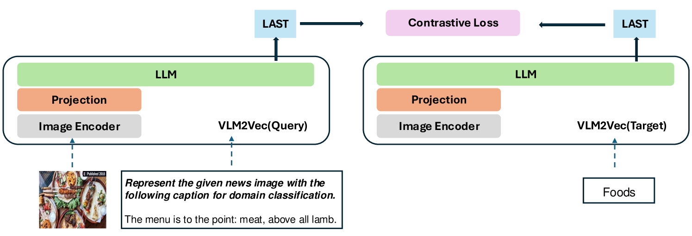
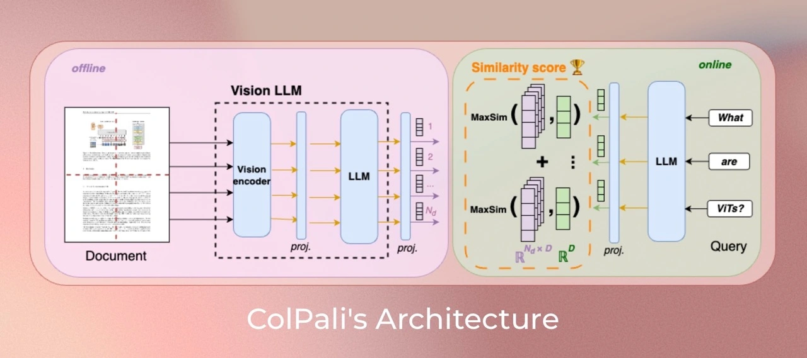
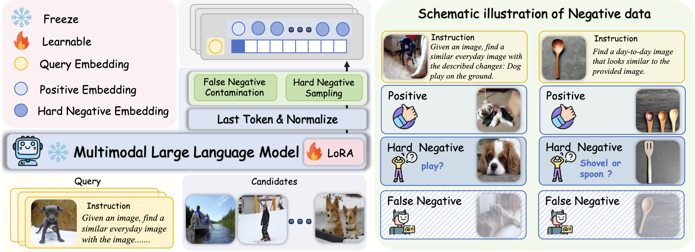
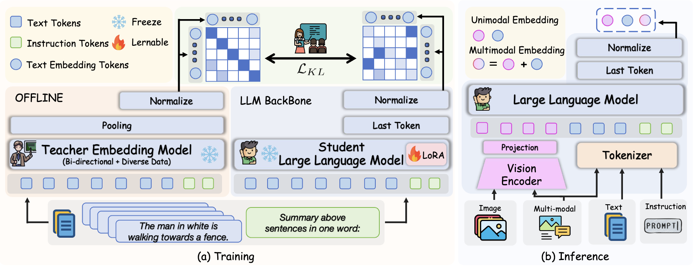

# 多模态 Embedding 大模型研究进展报告（2025–2026）

> 本报告系统梳理了 2025–2026 年间多模态 Embedding 大模型领域的研究进展。整合自两份既有文档（系统综述版 + 代表作深度解析版），并补充 2026 年中旬前值得关注的新工作。第 2–5 章以技术阅读 blog 风格展开：数据集与评测、训练方法与代表模型。文中各工作名称均直接链接至论文 / 代码 / 官方页面。

---

## 目录

1. [引言与领域概览](#1-引言与领域概览)
2. [常用数据集](#2-常用数据集)
3. [评估方法与基准](#3-评估方法与基准)
4. [训练策略](#4-训练策略)
5. [代表模型详解](#5-代表模型详解)
6. [趋势与展望](#6-趋势与展望)
7. [附录：两份原稿整合说明与新增文献](#7-附录两份原稿整合说明与新增文献)

---

## 1. 引言与领域概览

多模态 Embedding 模型旨在将不同模态（文本、图像、视频、音频等）的数据映射到统一的向量空间中，使得语义相似的跨模态数据在该空间中距离相近。这项技术是跨模态检索、多模态 RAG（检索增强生成）、视觉问答等应用的核心基础设施。

2025–2026 年，该领域经历了从**双塔架构（CLIP-style）到 MLLM-based 统一嵌入模型**的范式转变，并进一步向「全模态 + 推理增强嵌入」演进。关键趋势包括：

- **MLLM 成为主流骨干**：[Qwen3-VL](https://github.com/QwenLM/Qwen3-VL)、[LLaVA-OneVision](https://llava-vl.github.io/blog/2024-08-05-llava-onevision/) 等被广泛用作 Embedding 模型的基座
- **从双编码器到深度融合**：[Gemini Embedding 2](https://arxiv.org/abs/2605.27295) 等模型实现了任意交错的跨模态输入；开源侧 [Omni-Embed-Nemotron](https://arxiv.org/abs/2510.03458) / [OmniRet](https://arxiv.org/abs/2603.02098) 推进文–图–音–视频统一
- **训练效率大幅提升**：合成数据、多轮对比学习、GradCache、token 重采样等技术显著降低训练与推理成本
- **推理时扩展维度（MRL）**：Matryoshka 表示学习成为标配，支持灵活的嵌入维度
- **推理能力成为新前沿**：[MR²-Bench](https://arxivlens.com/paperview/details/mr-2-bench-going-beyond-matching-to-reasoning-in-multimodal-retrieval-4166-ffb0e88d) 揭示匹配≠推理；[UME-R1](https://arxiv.org/abs/2511.00405) / [Embed-RL](https://arxiv.org/abs/2602.13823) / [MMEmb-R1](https://arxiv.org/abs/2604.06156) / [PLUME](https://arxiv.org/abs/2604.02073) / [RIME](https://arxiv.org/abs/2604.22280) 等探索显式 CoT、潜在推理与改写式生成嵌入

---


## 2. 常用数据集

<a id="2-常用数据集"></a>

> 本章用阅读 blog 的方式讲清：多模态 Embedding **用什么数据练、用什么数据考**。建议先建立「预训练 / 微调 / 评测」三分法，再按任务类型看具体数据集；每类都配了 Demo，方便对照论文里的样本格式。

### 2.0 先分清三类数据：预训练、微调、评测

入门时最容易把「训练集」和「榜单」混在一起。可以先记这张分工表：

| 阶段 | 数据长什么样 | 要它干什么 | 典型例子 |
|------|--------------|------------|----------|
| **预训练** | 海量、偏脏、弱监督图文/多模态对 | 把空间大致摆正：图文能对上号 | LAION-5B、DataComp、DFN |
| **微调 / 指令对齐** | 中等规模、任务格式清晰、常带 instruction | 学会分类、检索、VQA、组合检索等具体玩法 | MMEB 训练集、ShareGPT4V、CIRR |
| **评测基准** | 规模可控、标签干净、协议固定 | 公平比谁强；尽量少用来「刷分训练」 | MS-COCO 测试集、MMEB OOD、MR²-Bench |

**一条经验**：预训练看「量与覆盖」，微调看「任务多样性与难负例」，评测看「是否测到你真正关心的能力」（匹配 / 组合 / 推理 / 长上下文 / 文档）。

```text
网页图文海量对 ──► 预训练（对齐）──► 多任务微调（听指令）──► 各基准评测
     ↑                                    ↑
  LAION / DataComp / 合成数据         MMEB / CIRR / ViDoRe 训练子集
```

---

### 2.1 预训练数据集：先把「模态对齐」学出来

预训练几乎都是 **（图像/视频/…, 文本）弱监督配对**：来自网络 alt-text、维基说明、过滤后的爬虫语料。质量参差，但规模足够让对比学习找到粗对齐。

| 数据集 | 规模 | 模态 | 一句话定位 |
|--------|------|------|------------|
| **[LAION-5B](https://laion.ai/blog/laion-5b/)** | 58.5 亿对 | 图文 | 开源大规模图文「燃料库」，CLIP 系常用 |
| **[DataComp](https://www.datacomp.ai/)** | 128 亿对（含多档子集） | 图文 | 强调「数据筛选算法」本身可研究 |
| **[CC3M](https://ai.google.com/research/ConceptualCaptions/) / [CC12M](https://github.com/google-research-datasets/conceptual-12m)** | 300 万 / 1200 万 | 图文 | 更干净的概念描述，常作中小规模实验 |
| **[COYO-700M](https://github.com/kakaobrain/coyo-dataset)** | 7.47 亿对 | 图文 | 过滤更严的大规模开源替代 |
| **[WIT](https://github.com/google-research-datasets/wit)** | 3760 万 | 图文（多语言） | 维基图文，适合多语言对齐 |
| **[DFN](https://arxiv.org/abs/2309.17425)** | ~50 亿对（筛选后） | 图文 | Apple 路线：用过滤网络提纯数据 |
| **[VLDA-HM](https://github.com/PKU-YuanGroup/LanguageBind)** | 1000 万 | 视频/红外/深度/音频/文本 | 语言为锚的多模态绑定语料 |
| **[PolyGen](https://arxiv.org/abs/2602.01370) 合成** | 可扩展 | 图文 | 多生成器同题多图，2025 后很火 |

#### 怎么读这些预训练集？

**1. 规模不是唯一真相**  
LAION-5B 很大，但噪声也大（错配、水印、色情/低质内容需过滤）。DataComp / DFN 的核心叙事是：**同样算力下，更好的筛选 > 盲目堆数据**。读论文时看到 “DFN-5B” 之类名字，重点看它的过滤策略，而不只是 “5B” 这个数字。

**2. 弱监督配对长什么样**  
一张图配一句（或几句）不一定完美的描述。训练目标通常是：配对当正例，同 batch 其他样本当负例。

#### Demo：预训练图文对

**LAION / CC3M 风格（弱监督）**

```text
[Image]  一只金毛犬在草地上追飞盘，阳光从左侧斜照。
[Text]   "golden retriever catching a frisbee in a sunny park"

特点: 描述大体对，但不保证完整、不保证无错配；靠规模平均掉噪声。
```

**WIT 多语言（同一图像，多语说明）**

```text
[Image]  埃菲尔铁塔夜景
[en]     "The Eiffel Tower illuminated at night in Paris"
[zh]     "巴黎埃菲尔铁塔的夜景灯光"
[fr]     "La Tour Eiffel illuminée la nuit à Paris"

用途: 学「跨语言共享视觉概念」——同一景象，不同语言描述应对齐到相近向量。
```

**PolyGen 合成（同一 caption，多生成器图像 = 多正例）**

```text
[Caption]  "a red ceramic mug on a wooden table, soft morning light"
[Img-A]    SDXL-Turbo（偏写实）
[Img-B]    SANA（偏插画）
[Img-C]    SD2（偏摄影）
→ A/B/C 都是该 caption 的正例；还可程序化生成「差一点就不对」的硬负例。
```

**初学者选型提示**

| 你的目标 | 更合理的预训练数据起点 |
|----------|------------------------|
| 复现/小规模实验 | CC3M / CC12M |
| 追开源大规模基线 | LAION 过滤子集、COYO、DataComp Medium/Large |
| 强调数据质量 | DFN 思路或自建过滤 |
| 多语言 | WIT + 多语言合成描述 |
| 视频/更多模态 | VLDA-HM 及后续绑定类语料 |
| 缺真实数据 | PolyGen / mmE5 等合成流水线 |

---

### 2.2 微调与评估数据集：按「任务形态」来记

评测和微调数据按**输入输出形态**分类，比按名字死记更有用。

#### 2.2.1 图像–文本检索（经典双塔考场）

这是最老也最常用的设定：**文找图 / 图找文**。库里有很多图像（或很多句子），看正确答案能否排进 Top-K。

| 数据集 | 规模 | 特点 |
|--------|------|------|
| **[MS-COCO](https://cocodataset.org/)** | ~12.3 万图，每图 5 句 | 通用场景「标准尺子」，论文几乎必报 |
| **[Flickr30K](https://shannon.cs.illinois.edu/DenotationGraph/)** | ~3.1 万图，每图 5 句 | 更偏日常相册风格，常与 COCO 并列 |
| **[ShareGPT4V](https://sharegpt4v.github.io/)** | ~10 万长描述 | GPT-4V 写的细粒度长 caption，利于长文本对齐 |
| **[Urban1K](https://huggingface.co/datasets/BeichenZhang/Urban1k)** | 1000 张 | 城市场景长描述检索（Long-CLIP 发布） |
| **[SugarCrepe](https://github.com/RAIVNLab/sugar-crepe)** | 自动构造硬负例 | 专门打「组合性」：属性绑错、关系颠倒 |

**任务在算法里怎么跑？**

```text
文→图:  Encode(text) 与  Encode(所有图) 算相似度，看真图是否进 Top-K
图→文:  Encode(image) 与  Encode(所有句) 算相似度，看真句是否进 Top-K
```

##### Demo：MS-COCO

```text
Image ID: 397133
[Image]  一名女子站在网球场边，手持球拍准备发球。

Captions（5 条都算正例）:
  1. "A woman with a tennis racket about to serve."
  2. "A female tennis player prepares to hit the ball."
  3. "Woman standing on a court holding a racket."
  4. "A tennis player in white preparing for a serve."
  5. "Athlete with racket on outdoor tennis court."

评测:
  Text→Image: 用 Caption-1 去图库里找 Image 397133
  Image→Text: 用图像去 caption 池里找上述正确描述之一
主指标: Recall@1 / @5 / @10
```

##### Demo：ShareGPT4V（长描述）

```text
[Image]  咖啡馆室内：木质吧台、吊灯、窗边两人交谈

[Long Caption]
"The photo shows a cozy café interior with warm wooden furniture.
A barista stands behind the counter preparing drinks, while two
customers sit by a large window with laptops. Soft pendant lights
hang from the ceiling, creating a relaxed afternoon atmosphere."

和 COCO 短句的差别: 更长、更细、更像「段落」；能暴露模型对长文本的退化。
```

##### Demo：SugarCrepe（组合性硬负例）

```text
[Image]  一只猫坐在蓝色椅子上

Positive:  "a cat sitting on a blue chair"
Hard Neg:  "a blue cat sitting on a chair"   ← 颜色绑错对象
Hard Neg:  "a chair sitting on a blue cat"   ← 主客体颠倒

意义: 袋袋词（bag-of-words）模型容易被骗；真正理解组合关系才过关。
```

---

#### 2.2.2 组合图像检索（Composed Image Retrieval）

用户说的不是纯文本，而是：**参考图 + 修改说明 → 目标图**。更接近电商「找同款但换个颜色/款式」。

| 数据集 | 规模 | 领域 |
|--------|------|------|
| **[CIRR](https://github.com/Cuberick-Orion/CIRR)** | ~2.1 万查询 | 真实场景开放域 |
| **[FashionIQ](https://github.com/XiaoxiaoGuo/fashion-iq)** | ~7.7 万查询 | 服装属性修改 |
| **[NIGHTS](https://github.com/princetonvisualai/nights)** | ~2 万图像对 | 人类感知相似度比较 |

查询通常要**联合编码**参考图与修改文本（或先分别编码再融合）：

```text
q = Encode(Reference Image, Modification Text)
在候选图库中检索 Target Image
```

##### Demo：CIRR

```text
[Reference]     一只棕色泰迪犬站在草地上
[Modification]  "same dog, but sitting and wearing a red scarf"
[Target]        同一只狗坐下并围红围巾

难点: 要保留「是同一只狗」的身份，又要执行「坐下 + 红围巾」的编辑。
```

##### Demo：FashionIQ

```text
[Reference]  黑色圆领短袖 T 恤
[Caption]    "is floral and has short sleeves"
[Target]     花卉印花短袖上衣

难点: 服装属性组合（领型、袖长、图案、材质）细且易混淆。
```

##### Demo：NIGHTS（哪张更像？）

```text
[Anchor]   日落海边剪影
[Image A]  同一场景、曝光略不同     ← 人类判为更相似
[Image B]  完全不同的雪山
标签: A 比 B 更接近 Anchor

用途: 学「人眼感知相似度」，而不只是像素级或标签级匹配。
```

---

#### 2.2.3 知识密集 VQA 与视觉文档

这类数据测的是：**能不能对着图/页面找到信息**，而不只是「图文像不像」。在 Embedding 设定里，常把「问题」编成 query，把「含答案的段落/页面/图像」编成候选文档。

| 数据集 | 测什么 |
|--------|--------|
| **[WebQA](https://webqna.github.io/)** | 多模态网页证据问答 |
| **[DocVQA](https://www.docvqa.org/)** | 文档页上的问答（表格、发票、表单） |
| **[InfoVQA](https://www.docvqa.org/datasets/infographicvqa)** | 信息图（饼图、流程、海报）问答 |
| **[VisualNews](https://github.com/FuxiaoLiu/VisualNews-Repository)** | 新闻图文，偏检索/事实相关 |
| **[ViDoRe](https://huggingface.co/vidore)** | 视觉文档检索专项（V1/V2/V3） |

##### Demo：DocVQA

```text
[Page Image]  扫描发票 PDF 页

Q: "What is the total amount due?"
A: "$1,245.00"

Q: "Who is the vendor?"
A: "Acme Supplies Ltd."

Embedding 视角: query=问题（可含页图），正例=含答案的那一页或那段区域表示。
```

##### Demo：InfoVQA

```text
[Infographic]  "2024 Global EV Market Share" 饼图+柱状图
Q: "Which country had the highest EV market share in 2024?"
A: "China"

难点: 要读懂版式与图例，不是只做自然照片描述。
```

##### Demo：ViDoRe（页级检索）

```text
[Query]   "What is the attention mechanism used in Transformer?"
[Corpus]  大量论文/手册的【页面截图】（常不先 OCR）
[Relevant] Attention Is All You Need 里含 Multi-Head Attention 图的那一页

评分: ColPali/ColQwen 等多向量 MaxSim；主指标常见 NDCG@10
```

##### Demo：WebQA

```text
[Question]  "What color is the dome of the Florence Cathedral?"
[Evidence]  维基页面截图 / 相关图片
[Answer]    "The dome is covered in red terracotta tiles."

特点: 答案依赖外部多模态证据，接近「检索增强」场景。
```

---

#### 2.2.4 MMEB：把异构任务「翻译」成同一种嵌入作业

[MMEB](https://www.emergentmind.com/topics/massive-multimodal-embedding-benchmark-mmeb)（随 [VLM2Vec](https://proceedings.iclr.cc/paper_files/paper/2025/hash/04261fce1705c4f02f062866717d592a-Abstract-Conference.html) 提出）的关键思想是：

> 分类、VQA、检索、Grounding……表面不同，但都可以写成  
> **`Instruction + Query → Embedding`，去靠近一个 Target Embedding**。

| 元任务 | 大约多少套数据 | 代表 |
|--------|----------------|------|
| 分类 Classification | ~10 | ImageNet-1K, SUN397, Food101, CIFAR-100 |
| 视觉问答 VQA | ~6 | OK-VQA, A-OKVQA, ScienceQA, TextVQA |
| 跨模态检索 Retrieval | ~8 | MS-COCO, NIGHTS, VisualNews-t2i |
| 视觉定位 Grounding | ~6 | RefCOCO, RefCOCO+, MSCOCO-Grounding |

##### Demo：统一成「指令条件化」格式

```text
# 分类 —— Target 是类别名文本
Instruction: "Represent the given image for classification"
Query:       <寿司拼盘图像>
Target:      "sushi"

# VQA —— Target 是能回答问题的文本
Instruction: "Find a passage that answers the question"
Query:       <图像> + "How many people are in the photo?"
Target:      "There are three people standing near the fountain."

# 检索 —— Target 是匹配图像（或其表示）
Instruction: "Retrieve an image that matches the given caption"
Query:       "a dog running on the beach at sunset"
Target:      <匹配图像>

# Grounding —— Target 是区域/区域描述
Instruction: "Represent the image region described by the caption"
Query:       <图像> + "the red car on the left"
Target:      <对应区域或描述>
```

**为什么这对初学者重要？**  
一旦接受这种格式，你读 VLM2Vec / UniME / Qwen3-VL-Embedding 时，就不会被「他们怎么把分类也做成对比学习」卡住——**类别名、答案句、目标图，都只是另一种「正例文档」**。

---

### 2.3 章节小结：数据怎么选

1. **先定能力再选数据**：只要图文召回 → COCO/Flickr；要改图检索 → CIRR/FashionIQ；要 PDF → ViDoRe/DocVQA；要通用多任务 → MMEB。  
2. **训练别只喂评测集**：会过拟合榜单；预训练用大而滤噪的语料，微调用任务混合。  
3. **Demo 里的「Hard Neg」值得收藏**：组合性、假负例、文档版式，是 2025–2026 拉开差距的地方。

---

## 3. 评估方法与基准

<a id="3-评估方法与基准"></a>

> 有了数据还不够——**怎么打分、考什么能力**，决定你会被榜单带着走，还是真正理解模型强弱。本章先讲指标直觉，再带读各大基准，最后总结 2025–2026 的评测共识。

### 3.0 评测在回答哪三个问题？

1. **找得到吗？**（召回）——正确答案有没有进 Top-K  
2. **排得准吗？**（排序）——越相关是否越靠前  
3. **泛化到哪？**（分布外 / 推理 / 长上下文）——换任务、换难度是否崩盘

Embedding 评测几乎都围着这三问转；不同基准只是把考卷出得更偏某一问。

---

### 3.1 核心评估指标：用「搜狗」例子建立直觉

假设库里有 1000 张图，其中只有 1 张是正确答案。模型给出一个排序列表。

| 指标 | 含义（白话） | 常见设置 | 什么时候看它 |
|------|--------------|----------|--------------|
| **Recall@K** | Top-K 里有没有答案（有则 1，无则 0；多正例则算比例） | K=1,5,10,50 | 检索主指标；COCO 常报 R@1/5/10 |
| **Precision@K** | Top-K 里有多少是对的 | MMEB 常用 **P@1** | 每个 query 通常一个硬正例时，P@1≈R@1 |
| **nDCG@K** | 排序质量：相关的越靠前越好，且有位置折损 | K=10 很常见 | 多档相关性、文档检索（ViDoRe） |
| **MRR** | 第一个正确答案排名的倒数的平均 | — | 很在意「第一条就对」 |
| **mAP** | 多正例时的精度–召回综合 | 多标签 | 一图多标注等场景 |

#### 小计算器：Recall@K 与 MRR

```text
正确文档排在第 3 名:
  Recall@1 = 0
  Recall@5 = 1
  MRR      = 1/3 ≈ 0.33

正确文档排在第 1 名:
  Recall@1 = 1
  MRR      = 1.0
```

#### nDCG 为什么「更严」？

它不只问「进没进 Top-K」，还问「是不是排得靠前、相关性等级对不对」。两个模型都能 R@10=1，但一个把正解排第 1、一个排第 10，nDCG 会拉开差距——所以 **ViDoRe / 文档检索更爱 nDCG@10**。

#### 读榜单时的坑

- **K 不同不能横比**：R@1 和 R@50 差一个数量级很正常。  
- **候选库规模不同不能横比**：库从 5K 扩到 5M，同一模型 R@1 会掉。  
- **In-distribution vs OOD**：在训练见过的数据集上很高、换一套就掉，说明泛化虚高。

---

### 3.2 主要基准平台：一张「考纲」地图

```text
                    ┌─ 匹配能力广不广 ──► MMEB / M-BEIR / MTEB v2
评测光谱 ──────────┼─ 文档页找不找得到 ──► ViDoRe
                    ├─ 组合绑得对不对 ──► Winoground / SugarCrepe
                    ├─ 会不会推理 ──► MR²-Bench
                    └─ 长上下文崩不崩 ──► MMLongEmbed
```

---

#### [MMEB](https://www.emergentmind.com/topics/massive-multimodal-embedding-benchmark-mmeb)：多模态嵌入的「高考总分」

| 版本 | 来源 | 规模印象 | 新增什么 |
|------|------|----------|----------|
| **V1** | [VLM2Vec](https://proceedings.iclr.cc/paper_files/paper/2025/hash/04261fce1705c4f02f062866717d592a-Abstract-Conference.html), ICLR 2025 | 36 数据集，4 元任务 | 分类 / VQA / 检索 / Grounding；20 ID + 16 OOD |
| **V2** | [VLM2Vec-V2](https://huggingface.co/papers/2507.04590), 2025.07 | ~78 任务 | 视频检索/定位/分类/问答、视觉文档 |
| **V3** | [MMEB-V3](https://arxiv.org/abs/2604.23321) (COLM 2026) | ~190 任务 | 音频、Agent（工具/GUI/记忆）；配套 **OmniSET** 诊断集 |

**主指标**：Precision@1 / Recall@1（多数子任务是「一查询一正例」）；VisDoc 常用 nDCG@5。

**实时榜**：[TIGER-Lab MMEB Leaderboard](https://huggingface.co/spaces/TIGER-Lab/MMEB-Leaderboard)（提交持续刷新）。

**MMEB-V3 / OmniSET 要点（2026.04）**  
MMEB-V3 把评测推进到「全模态 + Agent」。配套的 [OmniSET](https://arxiv.org/abs/2604.23321)（Omni-modality Semantic Equivalence Tuples）用跨模态语义等价元组，把「语义相似」与「模态效应」拆开诊断。论文三点结论值得记住：

1. 模型常检索不到指令指定的目标模态；  
2. 跨模态检索高度不对称，受 query 模态偏置主导；  
3. 指令诱导的表示偏移常常不够或方向不对，**不能可靠地做模态约束检索**。

这说明：仅扩大模态覆盖 ≠ 学会「听指令选模态」。

**MMEB-V2 Top（Overall / All，公开对照快照）**

> 来源综合：[Qwen3-VL-Embedding-8B 模型卡](https://huggingface.co/Qwen/Qwen3-VL-Embedding-8B) 重评表 + [MMEB Leaderboard CSV](https://huggingface.co/spaces/TIGER-Lab/MMEB-Leaderboard/raw/main/rankings/mmeb_ranking.csv)（约 2026-07 核查）。分数为 **All（78 任务平均）**；活榜会继续漂移。

| 排名 | 模型 | Size | All | 备注 |
|------|------|------|-----|------|
| 1 | [Qwen3-VL-Embedding-8B](https://huggingface.co/Qwen/Qwen3-VL-Embedding-8B) | 8B | **77.8–77.9** | Image≈80 / Video≈67 / VisDoc≈82 |
| 2 | [Seed-1.6-embedding-1215](https://seed.bytedance.com/en/blog/built-on-seed1-6-flash-seed-1-6-embedding-launched) | — | 76.9 | 闭源/半开源 |
| 3 | WeMM-Embedding-8B | ~8.8B | 73.9 | 榜单高位开放权重 |
| 4 | [IFM-TTE](https://huggingface.co/spaces/TIGER-Lab/MMEB-Leaderboard) / TTE 系 | 8B | ~73–74 | Think-Then-Embed |
| 5 | [Qwen3-VL-Embedding-2B](https://huggingface.co/Qwen/Qwen3-VL-Embedding-2B) | 2B | 73.3–73.4 | 小模型高性价比 |
| 6 | [RzenEmbed](https://arxiv.org/abs/2510.27350) / MMEmb-R1-4B 等 | 4–8B | ~71–73 | 推理增强路线追上中位 |
| 7 | [Ops-MM-embedding-v1](https://huggingface.co/OpenSearch-AI/Ops-MM-embedding-v1-7B) | 8B | ~67–69 | 长上下文也强 |
| 8 | [VLM2Vec-V2](https://huggingface.co/papers/2507.04590) | 2B | 59.2 | 方法开山、分数已被超越 |
| 9 | [GME-7B](https://huggingface.co/Alibaba-NLP/gme-Qwen2-VL-7B-Instruct) | 7B | ~57–59 | 融合模态合成代表作 |
| 10 | [GME-2B](https://huggingface.co/Alibaba-NLP/gme-Qwen2-VL-2B-Instruct) / [VLM2Vec](https://arxiv.org/abs/2410.05160) | 2B | ~48–55 | 早期基线 |

**怎么读这个榜？**  
总分高说明「通用匹配」强，但不自动等于：视频第一、文档第一、推理第一。看子任务表往往比看总分更有决策价值（例如视频看 [WAVE-7B](https://huggingface.co/tsinghua-ee/WAVE-7B)，文档看 ColQwen/Argus）。

---

#### [M-BEIR](https://huggingface.co/datasets/TIGER-Lab/M-BEIR)：偏「检索系统」的综合考场

- **规模**：10 个数据集、16 个检索任务、约 **560 万** 候选项  
- **覆盖**：图文检索、组合检索、知识密集检索等  
- **指标**：全局池上平均 **R@5**（Fashion200K / FashionIQ 用 R@10）  
- **基准主页**：[UniIR / M-BEIR](https://tiger-ai-lab.github.io/UniIR/) · **代表工作**：[MM-Embed](https://openreview.net/forum?id=vG8Mmp4OCP)

**M-BEIR Top 10（Global pool Avg R@5，论文报告）**

> 来源：[MM-Embed](https://arxiv.org/html/2411.02571) Table 1 与 [UniIR](https://tiger-ai-lab.github.io/UniIR/)；设置为从 **5.6M 异构候选池**检索。无持续公开排行榜时，以论文横向对比为准。

| 排名 | 模型 | 类型 | Avg R@5 |
|------|------|------|---------|
| 1 | [MM-Embed](https://openreview.net/forum?id=vG8Mmp4OCP) | MLLM bi-encoder + 持续文本微调 | **52.7** |
| 2 | Mhard(NVEmb) | NV-Embed 系 + 模态感知硬负例 | 52.3 |
| 3 | Mhard(LLaVa-P) | LLaVA-Next + 硬负例 | 51.9 |
| 4 | [UniIR](https://tiger-ai-lab.github.io/UniIR/) (CLIPSF) | CLIP 特征融合 + 指令多任务 | 50.6 |
| 5 | Mhard(CLIPSF) | CLIPSF + 硬负例 | 48.3 |
| 5 | Mrand(LLaVa-P) | LLaVA-Next + 随机负例 | 48.3 |
| 7 | Mrand(LLaVa-E) | LLaVA-Next（E 池化） | 47.9 |
| 8 | Mrand(CLIPSF) | CLIPSF + 随机负例 | 47.4 |
| 9 | Mrand(NVEmb) | NV-Embed 微调（随机负例） | 47.2 |
| 10 | [UniIR](https://tiger-ai-lab.github.io/UniIR/) (BLIPFF) / BLIPFF | BLIP 系多任务 | ~45.5–46.8 |

**和 MMEB 的差别（直觉）**：MMEB 更像「嵌入表示全能测试」；M-BEIR 更像「检索器在大型候选库上的实战」。

---

#### [UMRB](https://openaccess.thecvf.com/content/CVPR2025/html/Zhang_Bridging_Modalities_Improving_Universal_Multimodal_Retrieval_by_Multimodal_Large_Language_CVPR_2025_paper.html)：通用多模态检索（含融合模态）

- **来源**：[GME](https://arxiv.org/abs/2412.16855)（CVPR 2025）汇集约 **47** 个检索数据集  
- **覆盖**：text↔text、image↔image、跨模态，以及 **fused-modal**（图文复合 query/candidate）  
- **指标**：子任务用 nDCG@10 / nDCG@5 / R@5/R@10，Overall 为异构汇总  
- **读点**：公开数据几乎只有 text↔image，融合模态稀缺——这正是 GME 合成 110 万 fused-modal 数据的动机

---

#### [MR²-Bench](https://arxivlens.com/paperview/details/mr-2-bench-going-beyond-matching-to-reasoning-in-multimodal-retrieval-4166-ffb0e88d)：从「长得像」到「想得通」

- **定位**：首个强调**推理密集**的多模态检索基准（约 1,309 条精标查询）  
- **考什么**：逻辑、空间、因果等——仅靠浅层外观相似度不够  
- **关键数字**（务必记住数量级）：  
  - 强模型在 MMEB 上可到 **~77.8 R@1**  
  - 同一时代模型在 MR² 上可掉到 **~9.9 R@1**（约 **68 个点**的鸿沟）  
  - 最佳约 **30.68 nDCG@10**；加 GPT-5 重排后约 **45.90**  
- **官方 Mini-Leaderboard**：[VectorSpaceLab/MR2-Bench](https://github.com/VectorSpaceLab/MR2-Bench)

**MR²-Bench Top 10（Avg nDCG@10，官方 Mini-Leaderboard）**

> 指标为 12 个子任务宏平均 nDCG@10。表中同时收录「原生多模态嵌入」与「文本嵌入 + 图像 caption」两条路线，便于对照。

| 排名 | 模型 | 类型 | Avg nDCG@10 |
|------|------|------|-------------|
| 1 | [Seed-1.6-Embedding](https://seed.bytedance.com/en/blog/built-on-seed1-6-flash-seed-1-6-embedding-launched) | 多模态嵌入 | **30.68** |
| 2 | [MM-Embed](https://openreview.net/forum?id=vG8Mmp4OCP) | 多模态嵌入 | 30.23 |
| 3 | ReasonIR + Captions | 文本推理检索器 + 图注 | 25.72 |
| 4 | BGE-Reasoner + Captions | 文本推理检索器 + 图注 | 25.35 |
| 5 | [VLM2Vec-v2](https://huggingface.co/papers/2507.04590) | 多模态嵌入 | 23.72 |
| 6 | Diver-Embed + Captions | 文本推理检索器 + 图注 | 23.59 |
| 7 | [GME](https://huggingface.co/Alibaba-NLP/gme-Qwen2-VL-7B-Instruct) | 多模态嵌入 | 21.59 |
| 8 | Qwen3 + Captions | 文本嵌入 + 图注 | 20.17 |
| 9 | BGE-VL | 多模态嵌入 | 19.53 |
| 10 | CLIP / BGE-M3 + Captions | 基线 | ~18.6–18.7 |

##### Demo：需要因果推理的检索

```text
[Query Image]  水杯倾倒，水流向桌边
[Query Text]   "Which image shows what happens next due to gravity?"
[Candidates]
  A. 水落在地板上形成水洼     ← 正解（物理因果）
  B. 水杯被扶正且无水渍       ← 外观相关但违因果
  C. 干净空桌面               ← 更像「结果被擦掉」

浅层匹配模型易选 B/C；MR² 专门惩罚这种「像但不对」。
```

**读完带走**：只报 MMEB 的论文，可能高估了推理检索能力；MR² 是 2025–2026 最刺痛人的镜子。

---

#### [MMLongEmbed](https://arxiv.org/abs/2606.14747)：上下文一长就退化吗？

- **定位**：长上下文多模态 Embedding（可到 **32K** token 量级）  
- **四大任务**：Needle-in-a-Haystack（视觉定位）、多源推理、逻辑摘要、时序摘要  
- **实验规模**：约 11 个模型（开源为主 + 闭源对照）  

**MMLongEmbed Top（Avg P@1，论文 Table 3）**

> 来源：[MMLongEmbed](https://arxiv.org/html/2606.14747) Table 3 全任务平均 Precision@1。官方评测集规模有限，下表按论文报告分数排序（不足 10 个时如实列出）。

| 排名 | 模型 | Size | Avg P@1 |
|------|------|------|---------|
| 1 | [Ops-MM-embedding-v1-7B](https://huggingface.co/OpenSearch-AI/Ops-MM-embedding-v1-7B) | ~8B | **53.90** |
| 2 | [Qwen3-VL-Embedding-8B](https://huggingface.co/Qwen/Qwen3-VL-Embedding-8B) | 8B | 53.41 |
| 3 | [Qwen3-VL-Embedding-2B](https://huggingface.co/Qwen/Qwen3-VL-Embedding-2B) | 2B | 52.31 |
| 4 | Doubao-Seed-1.6（闭源） | — | 52.11 |
| 5 | [Ops-MM-embedding-v1-2B](https://huggingface.co/OpenSearch-AI/Ops-MM-embedding-v1-2B) | 2B | 48.18 |
| 6 | [Embed-RL-4B](https://huggingface.co/ZoengHouNaam/Embed-RL-4B) | 4B | 40.84 |
| 7 | [Embed-RL-2B](https://huggingface.co/ZoengHouNaam/Embed-RL-2B) | 2B | 39.28 |
| 8 | [GME-Qwen2-VL-7B](https://huggingface.co/Alibaba-NLP/gme-Qwen2-VL-7B-Instruct) | 7B | 24.63 |
| 9 | [GME-Qwen2-VL-2B](https://huggingface.co/Alibaba-NLP/gme-Qwen2-VL-2B-Instruct) | 2B | 23.10 |

##### Demo：多模态「大海捞针」

```text
[Context]  拼接约 50 页幻灯片截图（16K–32K tokens）
[Needle]   藏在第 37 页: "Project budget is $2.4M"
[Query]    "What is the project budget mentioned in the slides?"

考察: 超长交错图文里，关键信息是否仍能被嵌入/检索定位。
```

**读完带走**：长上下文不是「上下文窗口写得大就行」；嵌入质量常随长度**可预测地下滑**。同系列里 8B 相对 2B 提升往往很小（甚至在 Hard 子集更差），说明**训练策略与上下文建模**比单纯堆参数更关键。

---

#### [ViDoRe](https://huggingface.co/vidore)：视觉文档检索专项

- 为 [ColPali](https://huggingface.co/vidore/colpali) / [ColQwen](https://huggingface.co/athrael-soju/colqwen3.5-4.5B-v3) 等「页当图像、多向量打分」路径服务  
- **V1/V2**：ArxivQA、DocVQA、InfoVQA 等多文档类型  
- **V3（2026）**：多语言；主指标 **NDCG@10**  
- **实时榜**：[ViDoRe V3 · MTEB](https://mteb-leaderboard.hf.space/benchmark/ViDoRe(v3)) / [vidore-leaderboard](https://huggingface.co/spaces/vidore/vidore-leaderboard)

**ViDoRe V3 Top 10（Mean Task / nDCG@10，2026-04-20 快照）**

> 来源：[colqwen3.5-4.5B-v3 模型卡](https://huggingface.co/athrael-soju/colqwen3.5-4.5B-v3) 捕获的公开榜；活榜会随新提交变化。

| 排名 | 模型 | Params | Mean (Task) |
|------|------|--------|-------------|
| 1 | [nemotron-colembed-vl-8b-v2](https://arxiv.org/html/2602.03992v2) | 8.7B | **63.42** |
| 2 | webAI-ColVec1-9b | 9.4B | 63.00 |
| 3 | webAI-ColVec1-4b | 4.5B | 62.22 |
| 4 | tomoro-colqwen3-embed-8b | 8.0B | 61.59 |
| 5 | nemotron-colembed-vl-4b-v2 | 4.8B | 61.54 |
| 6 | [colqwen3.5-4.5B-v3](https://huggingface.co/athrael-soju/colqwen3.5-4.5B-v3) | 4.6B | 61.46 |
| 7 | [Ops-Colqwen3-4B](https://huggingface.co/OpenSearch-AI) | 4.8B | 61.17 |
| 8 | tomoro-colqwen3-embed-4b | 4.0B | 60.20 |
| 9 | llama-nemotron-colembed-vl-3b-v2 | 4.4B | 59.79 |
| 10 | [jina-embeddings-v4](https://huggingface.co/jinaai/jina-embeddings-v4) | 3.9B | 57.52 |

**ViDoRe V1+V2 Top 10（Avg nDCG@5，同快照）**

| 排名 | 模型 | Avg |
|------|------|-----|
| 1 | Ops-Colqwen3-4B | **84.9** |
| 2 | nemotron-colembed-vl-8b-v2 | 84.8 |
| 3 | nemotron-colembed-vl-4b-v2 | 83.9 |
| 4 | colqwen3.5-4.5B-v3 | 83.7 |
| 5 | llama-nemotron-colembed-vl-3b-v2 | 83.6 |
| 6 | tomoro-colqwen3-embed-8b | 83.5 |
| 7 | EvoQwen2.5-VL-Retriever-7B-v1 | 83.4 |
| 8 | tomoro-colqwen3-embed-4b | 83.2 |
| 9 | llama-nemoretriever-colembed-3b-v1 | 83.1 |
| 10 | SauerkrautLM-ColQwen3-8b-v0.1 | 82.9 |

> 另：[Argus-9B](https://arxiv.org/abs/2606.04300) 在 V1+V2 上报告 **86.0 NDCG@5**（OOD V2 提升明显），是否已完整入库活榜需以 [MTEB ViDoRe](https://mteb-leaderboard.hf.space/benchmark/ViDoRe(v3)) 为准。

**和 DocVQA 的关系**：DocVQA 偏「给定页问答」；ViDoRe 偏「先在很多页里找到那一页」。做 PDF RAG，ViDoRe 往往比 COCO 更相关。

---

#### [MTEB v2](https://huggingface.co/blog/isaacchung/mteb-v2)：从纯文本榜到多模态接口

- 经典 MTEB 是文本嵌入总榜；**v2** 把图文等模态纳入同一评价基础设施  
- 统一检索/重排任务接口，便于横向对比与统计分析  
- 适合问：「我的多模态模型，纯文本能力掉了多少？（对齐税）」  
- **实时榜**：[MTEB Leaderboard](https://huggingface.co/spaces/mteb/leaderboard)

**Multilingual / MMTEB Mean (Task) Top 10（公开对照快照）**

> 来源：[Qwen3-VL-Embedding-8B 模型卡](https://huggingface.co/Qwen/Qwen3-VL-Embedding-8B) MMTEB 表 + 社区汇总；活榜（尤其 English / Multilingual 分区）分数会继续刷新。此处用 **Mean (Task)**，方便对照「多模态模型的文本对齐税」。

| 排名 | 模型 | Size | Mean (Task) |
|------|------|------|-------------|
| 1 | [Qwen3-Embedding-8B](https://huggingface.co/Qwen/Qwen3-Embedding-8B) | 8B | **70.58** |
| 2 | [Qwen3-Embedding-4B](https://huggingface.co/Qwen/Qwen3-Embedding-4B) | 4B | 69.45 |
| 3 | [Gemini Embedding](https://ai.google.dev/gemini-api/docs/embeddings) | API | 68.37 |
| 4 | [Qwen3-VL-Embedding-8B](https://huggingface.co/Qwen/Qwen3-VL-Embedding-8B) | 8B | 67.88 |
| 5 | [Qwen3-Embedding-0.6B](https://huggingface.co/Qwen/Qwen3-Embedding-0.6B) | 0.6B | 64.33 |
| 6 | [Qwen3-VL-Embedding-2B](https://huggingface.co/Qwen/Qwen3-VL-Embedding-2B) | 2B | 63.87 |
| 7 | [multilingual-e5-large-instruct](https://huggingface.co/intfloat/multilingual-e5-large-instruct) | 0.6B | 63.22 |
| 8 | [gte-Qwen2-7B-instruct](https://huggingface.co/Alibaba-NLP/gte-Qwen2-7B-instruct) | 7B | 62.51 |
| 9 | Cohere-embed-multilingual-v3.0 | API | 61.12 |
| 10 | [GritLM-7B](https://huggingface.co/GritLM/GritLM-7B) | 7B | 60.92 |

> 社区后续还有 [KaLM-Embedding-Gemma3-12B](https://www.codesota.com/benchmarks/mteb) 等更高分提交（约 72+），读活榜时请以当前分区与任务集合为准。多模态旗舰 Qwen3-VL-Embedding-8B（67.88）相对专用文本版 Qwen3-Embedding-8B（70.58）低约 **2.7** 点，就是典型的「对齐税」。

---

#### [Winoground](https://huggingface.co/datasets/facebook/winoground)：组合绑定的「显微镜」

- 典型题：`"phone on a map"` vs `"map on a phone"`  
- **随机基线**：Text/Image **25%**，Group **16.67%**；人类 Group 约 **85.5%**  
- 很强的双塔嵌入也常在 Text **30–40%**、Group 远低于人类；公开报道里 [Apple DFN5B-H](https://huggingface.co/apple/DFN5B-CLIP-ViT-H-14-378) 约 **35.2%** 仍远未「解决」  
- **注意**：生成式 VLM + 特殊推理协议（如 Componential Analysis / SimpleMatch）可以把分数抬得很高，但不等于标准嵌入相似度评测

**Winoground 经典对照（标准配对打分）**

> 以原论文 [Thrush et al., 2022](https://arxiv.org/abs/2204.03162) 为主，按 **Group Score** 排序；并补充后续常被引用的现代双塔结果。这不是持续更新活榜，但足以说明：组合绑定仍远未解决。参考线：Text/Image 随机 **25%**，Group 随机 **16.67%**，人类 Group **85.5%**。

| 排名 | 模型 | Text | Image | Group | 备注 |
|------|------|------|-------|-------|------|
| — | MTurk Human | 89.5 | 88.5 | **85.5** | 人类上界 |
| 1 | VinVL | 37.75 | 17.75 | **14.50** | 原论文较强 ITM 系 |
| 2 | FLAVA ITM | 32.25 | 20.50 | 14.25 | 原论文 |
| 3 | ViLLA large | 37.00 | 13.25 | 11.00 | 原论文 |
| 4 | UNITER large | 38.00 | 14.00 | 10.50 | 原论文 |
| 5 | UNITER base | 32.25 | 13.25 | 10.00 | 原论文 |
| 6 | ViLT | 34.75 | 14.00 | 9.25 | 原论文 |
| 7 | FLAVA Contrastive | 25.25 | 13.50 | 9.00 | 原论文 |
| 8 | CLIP ViT-B/32 | 30.75 | 10.50 | 8.00 | 原论文双塔基线 |
| 9 | ViLLA base | 30.00 | 12.00 | 8.00 | 原论文 |
| 10 | LXMERT / 多数早期双塔 | ~19–24 | ~7 | ~4–5 | Group 常低于随机 |

> 后续数据过滤更好的双塔（如 [Apple DFN5B-H](https://huggingface.co/apple/DFN5B-CLIP-ViT-H-14-378)）在公开综述中常报约 **35.2%** 的组合性相关分数，仍远低于人类；生成式 VLM + 特殊推理协议可显著抬分，但与「纯嵌入相似度」评测不可直接横向对比。

##### Demo

```text
Caption A: "a phone on a map"
Caption B: "a map on a phone"
Image A:   手机放在纸质地图上
Image B:   手机屏幕显示地图 App

正确: (A,A) + (B,B)
打乱: 交叉配对应被判错

测的是: 关系/介词绑定，而不是「图里有没有 phone 和 map 这两个词」。
```

---

### 3.3 评测发现总结（2025–2026 共识）

1. **没有一家包打所有子任务**：[Gemini Embedding 2](https://arxiv.org/abs/2605.27295) 闭源综合强；开源总分常见 [Qwen3-VL-Embedding-8B](https://arxiv.org/abs/2601.04720) 领先，但视频、文档可能另有状元（如 [WAVE-7B](https://arxiv.org/abs/2509.21990)）。  
2. **开源在匹配类任务上已极具竞争力**：小到 2B 级也可能在部分跨模态检索上打过闭源 API。  
3. **组合推理仍难**：Winoground / SugarCrepe 证明「词都对、关系错」依然普遍。  
4. **长上下文退化是系统性的**：MMLongEmbed 画出了随长度下滑的曲线。  
5. **推理是最大短板**：MR² 相对 MMEB 的约 68pp 差距，说明当前嵌入仍偏浅层匹配。

### 3.4 给初学者的「读榜清单」

拿到一篇新论文的表格时，按顺序问：

1. 主榜是 **MMEB 总分** 还是子任务？有没有 OOD？  
2. 有没有报 **ViDoRe / 文档**？（做 RAG 必看）  
3. 有没有碰 **MR² / Winoground**？（宣称「理解强」时必看）  
4. 指标是 R@K 还是 nDCG？**K 和候选库多大**？  
5. 多模态变强后，**纯文本 MTEB** 掉了多少？

---

## 4. 训练策略

> 本章用「技术阅读 blog」的方式，把多模态 Embedding 训练里最常出现的概念拆开讲清楚。如果你刚入门，建议按顺序读：先理解「对比学习在干什么」，再看「四种训练范式差在哪」，最后才是合成数据、硬负样本、MRL、蒸馏这些工程技巧。

> **代码与图片说明**：代码是为解释核心机制而写的 PyTorch 教学实现，省略了生产环境中的分布式通信、混合精度、异常处理和模型专属 processor 适配；论文示意图均保存在仓库 `assets/papers/`，图注链接到原论文或官方仓库。


### 4.0 先建立直觉：Embedding 训练到底在优化什么？

把一张图、一段文字、一页 PDF、一段视频，分别压成一个（或一组）固定长度的向量，就叫 Embedding。训练的目标很朴素：

> **语义相近的东西，向量要靠近；语义无关的东西，向量要远离。**

检索时，只要算查询向量与库中向量的相似度（常用余弦相似度），就能把最相关的结果排到前面。所以训练不是教模型「生成答案」，而是教它**组织空间**：让「对的邻居」聚在一起。

工业界把这件事做成对比学习：每个样本有一个正例（该匹配的），一堆负例（不该匹配的）。损失函数负责惩罚「正例不够近」和「负例不够远」。后面所有花活——换损失、换架构、造合成数据、挖硬负例——都是在更好地完成这件事。

---


### 4.1 核心损失函数：模型怎么学会「靠近 / 远离」


#### InfoNCE（CLIP 族的标准答案）

[CLIP](https://openai.com/research/clip) 把 InfoNCE 带进了图文对齐。用一个 batch 里的例子理解最直观：

假设一个 batch 有 3 对图文：`(图1, 文1)`、`(图2, 文2)`、`(图3, 文3)`。对「图1」来说：

- 正例只有 `文1`
- 负例是同 batch 里的 `文2`、`文3`（以及分布式训练时其他 GPU 上的文本）

模型先算图1与所有文本的相似度，再做 Softmax，目标是：**正例的概率尽量高**。公式写作：

$$\mathcal{L}_{\text{InfoNCE}} = -\frac{1}{N}\sum_{i=1}^{N}\log\frac{\exp(\text{sim}(z_i^I, z_i^T) / \tau)}{\sum_{j=1}^{N}\exp(\text{sim}(z_i^I, z_j^T) / \tau)}$$

其中 $\tau$（温度）控制 Softmax 的「尖锐程度」：$\tau$ 越小，模型越被迫把正负例分得更开。CLIP 还做了对称版本：图找文 + 文找图，两边损失取平均。

##### 代码示例：对称 InfoNCE

下面是最小但完整的 PyTorch 写法。约定 `image_emb` 和 `text_emb` 的形状均为 `[batch_size, hidden_dim]`，且第 `i` 张图与第 `i` 段文本互为正例。

```python
import torch
import torch.nn.functional as F


def symmetric_info_nce(
    image_emb: torch.Tensor,
    text_emb: torch.Tensor,
    temperature: float = 0.02,
) -> torch.Tensor:
    # 余弦相似度要求先做 L2 归一化。
    image_emb = F.normalize(image_emb, dim=-1)
    text_emb = F.normalize(text_emb, dim=-1)

    # [B, D] @ [D, B] -> [B, B]
    # 对角线 logits[i, i] 是正例，其余位置是 in-batch negatives。
    logits = image_emb @ text_emb.T / temperature
    labels = torch.arange(logits.size(0), device=logits.device)

    image_to_text = F.cross_entropy(logits, labels)
    text_to_image = F.cross_entropy(logits.T, labels)
    return (image_to_text + text_to_image) / 2


# 模拟 3 对图文。真实训练中这两个张量来自图像塔和文本塔。
image_emb = torch.randn(3, 768, requires_grad=True)
text_emb = torch.randn(3, 768, requires_grad=True)

loss = symmetric_info_nce(image_emb, text_emb)
loss.backward()
```

读代码时抓住三点：

1. **正例由矩阵对角线定义**，所以 DataLoader 必须保证图文顺序严格对齐；
2. **归一化后点积就是余弦相似度**，否则向量模长可能成为模型走捷径的方式；
3. 分布式训练通常会先 `all_gather` 其他 GPU 的向量，再计算更大的相似度矩阵，以获得更多负例。

**为什么大家总强调 Batch Size？**  
InfoNCE 的负例主要来自同 batch。batch 越大，负例越多、越多样，学到的判别边界越稳。CLIP 用到 32,768，就是在用「海量 in-batch negatives」换对齐质量。

> **读论文时常看到的细节**：训练收敛后 $\tau$ 往往掉到 ~0.01，余弦相似度大多挤在 0 附近，即便强匹配也很少超过 0.35–0.40。这不代表模型差，而是对比学习几何里的常态——真正重要的是**相对排序**，不是绝对分数。


#### [SigLIP](https://www.emergentmind.com/topics/sigmoid-loss-for-language-image-pre-training-siglip)：把「多分类」改成「一对一判断」

InfoNCE 有个隐式假设：同 batch 里除了正例以外都是负例。但现实中，batch 里可能碰巧出现另一张也很匹配的图——这叫**假负例（false negative）**。Softmax 会强迫它们互相竞争，训练信号被污染。

SigLIP 换了思路：不再做「在 N 个候选里选 1 个」的 Softmax，而是对每一个（图, 文）配对做独立的 Sigmoid 二分类——「这对是不是匹配？」

$$\mathcal{L}_{\text{SigLIP}} = -\frac{1}{N}\sum_{i,j}\log\sigma(z_{ij} \cdot (t \cdot x_i^\top y_j + b))$$

##### 代码示例：SigLIP 的逐对二分类

SigLIP 不再把一整行看成一个多分类问题，而是把相似度矩阵中的每个格子看成独立二分类。对角线标签为 `+1`，非对角线为 `-1`。

```python
import torch
import torch.nn.functional as F


def siglip_loss(
    image_emb: torch.Tensor,
    text_emb: torch.Tensor,
    logit_scale: torch.Tensor,
    logit_bias: torch.Tensor,
) -> torch.Tensor:
    image_emb = F.normalize(image_emb, dim=-1)
    text_emb = F.normalize(text_emb, dim=-1)

    logits = image_emb @ text_emb.T
    logits = logits * logit_scale.exp() + logit_bias

    batch_size = logits.size(0)
    labels = -torch.ones_like(logits)
    labels.fill_diagonal_(1.0)

    # -log(sigmoid(label * logit))
    pairwise_loss = -F.logsigmoid(labels * logits)
    return pairwise_loss.mean()


B, D = 4, 768
image_emb = torch.randn(B, D, requires_grad=True)
text_emb = torch.randn(B, D, requires_grad=True)
logit_scale = torch.tensor(0.0, requires_grad=True)
logit_bias = torch.tensor(-10.0, requires_grad=True)

loss = siglip_loss(image_emb, text_emb, logit_scale, logit_bias)
loss.backward()
```

工程实现还会做 **loss 分块**：不用一次物化完整的 `[B, B]` 矩阵，而是按文本块或图像块计算，从而降低峰值显存。

直觉对比：


|           | InfoNCE                            | SigLIP                   |
| --------- | ---------------------------------- | ------------------------ |
| 问题形式      | 在 batch 内做多分类                      | 对每个配对做是/否判断              |
| 假负例       | 会互相抢概率                             | 不直接竞争，更宽容                |
| 通信/内存     | 常需 all-gather，偏 $\mathcal{O}(N^2)$ | 更易扩展，接近 $\mathcal{O}(N)$ |
| Batch 敏感度 | 很吃大 batch                          | 从小 batch 到 ~32K 都更稳      |


**2025 年理论补全**（NeurIPS 2025）：[Bangachev 等人](https://arxivlens.com/paperview/details/global-minimizers-of-sigmoid-contrastive-loss-2478-72532172) 用 **(m, b_rel)-Constellations** 刻画 Sigmoid 对比损失的全局最小解，发现嵌入几何会出现相变（ETF 相 / 反足相 / 混合相），并提出相对偏置参数化（LRB-Sig）加速收敛。对初学者，记住一句即可：**SigLIP 不只是工程上更好训，其最优解的几何结构也正在被理论看清。**

**[SigLIP 2](https://arxiv.org/abs/2502.14786)（Google DeepMind, 2025）**：把 sigmoid 损失与 captioning 预训练（LocCa）、自蒸馏、掩码预测、在线数据筛选统一成一条配方；语料基于 [WebLI](https://arxiv.org/abs/2209.06794)（约 100 亿图像 / 109 语）。发布 ViT-B/L/So400m/g 多档，并提供多分辨率与保持原生长宽比的 NaFlex 变体。工程选型上，它仍是**最常用的开源视觉–语言双塔骨干之一**（如 PaliGemma 2）；代码与权重见 [big_vision SigLIP 2](https://github.com/google-research/big_vision/blob/main/big_vision/configs/proj/image_text/README_siglip2.md)。

#### 其他常见损失：各管一类任务

真实系统很少只用一种损失。按任务选型更常见：


| 损失函数                                                                   | 它在优化什么                              | 什么时候用        | 代表工作                                                    |
| ---------------------------------------------------------------------- | ----------------------------------- | ------------ | ------------------------------------------------------- |
| **CoSENT**                                                             | 相似度分数的相对排序是否合理                      | STS（语义文本相似度） | [Qwen3-VL-Embedding](https://arxiv.org/abs/2601.04720)  |
| **KL 散度**                                                              | 让学生分布贴近教师分布                         | 知识蒸馏、软标签对齐   | [UniME](https://dl.acm.org/doi/10.1145/3746027.3754845) |
| **Jensen-Shannon**                                                     | 更对称的分布对齐                            | 软匹配分数蒸馏      | [UniME-V2](https://arxiv.org/abs/2510.13515)            |
| **Triplet**                                                            | anchor-positive 近、anchor-negative 远 | 早期排序模型       | 经典度量学习                                                  |
| **Listwise**                                                           | 一整页候选列表的排序质量                        | 训练重排序器       | Reranker 阶段                                             |
| **[GCL](https://neurips.cc/virtual/2025/loc/san-diego/poster/116946)** | 任意模态在 mini-batch 内互相对比              | 不想构造严格三元组时   | NeurIPS 2025                                            |


**一句话记忆**：检索主损失多用 InfoNCE/SigLIP；要「像老师一样打分」用 KL/JS；要「把列表排好」用 listwise。

---


### 4.2 四种训练范式：同一目标，四种「怎么把模态接到一起」

可以把范式理解成四种「工厂流水线」。产品都是 Embedding，但车间布局不同。

#### 范式一：双塔对比预训练（CLIP-style）

```text
  图像 ──► [图像编码器] ──► 向量_I ─┐
                                    ├─► 对比损失（InfoNCE / SigLIP）
  文本 ──► [文本编码器] ──► 向量_T ─┘
```

- **代表**：[CLIP](https://arxiv.org/abs/2103.00020)、[SigLIP](https://arxiv.org/abs/2303.15343) / [SigLIP 2](https://arxiv.org/abs/2502.14786)、[Jina CLIP v2](https://huggingface.co/jinaai/jina-clip-v2)、[nomic-embed-vision](https://huggingface.co/nomic-ai/nomic-embed-vision-v1)
- **怎么训**：两个编码器互不看对方内部状态，只在最后用相似度对齐。
- **为什么好用**：线上可以**离线算好**所有图像向量入库；查询来了只编码文本，再做向量检索。延迟低、吞吐高。
- **硬伤**：模态之间没有深度交互。遇到「红围巾的狗 vs 坐着的狗」这类组合修改，或「phone on a map」这类语序敏感问题，双塔往往不够细。

> 适合：大规模召回、延迟敏感、图文检索为主的业务。


#### 范式二：MLLM 适配（把会聊天的多模态大模型，改造成会检索的编码器）

2024–2026 年的主旋律。思路不是从零训 Embedding，而是：

> 拿一个已经会看图、会理解指令的 MLLM（如 Qwen-VL、LLaVA），用对比学习把它「拧」成编码器。



*图 4-1：[VLM2Vec](https://arxiv.org/abs/2410.05160) 的训练框架。左、右两侧可以共享同一个 VLM；输入可分别是文本、图像或图文组合，最终都压缩为单向量。*

- **代表**：[VLM2Vec](https://proceedings.iclr.cc/paper_files/paper/2025/hash/04261fce1705c4f02f062866717d592a-Abstract-Conference.html)、[UniME](https://dl.acm.org/doi/10.1145/3746027.3754845)、[MM-Embed](https://openreview.net/forum?id=vG8Mmp4OCP)、[Qwen3-VL-Embedding](https://arxiv.org/abs/2601.04720)
- **关键技巧（读论文高频词）**：
  - **指令条件化**：同样一张图，加不同 instruction 会得到不同向量——「用于分类」和「用于检索」不再共用一个死板表示。
  - **LoRA**：只训练低秩适配器（rank 常取 8–16），基座知识尽量保留，省显存也少灾难性遗忘。
  - **GradCache**：对比学习想要大 batch，但 MLLM 显存吃紧。GradCache 把「前向算表征」和「反传算梯度」拆开缓存，用时间换有效 batch size。
  - **多阶段训练**：先大规模对齐 → 再多任务精调 → 再蒸馏/合并，避免一步到位不稳定。
  - **算力数量级**：开源 MLLM→Embedding 微调常见 **8×80GB GPU**；工业预训练/合成与 WAVE/UME-R1 等可达 **几十到上百卡**。详见 [§5.16](#513-训练--推理算力速查公开披露汇总)。

> 适合：要统一分类 / VQA / 检索 / grounding、需要理解复杂指令的通用 Embedding。

##### 代码示例：从 MLLM 的最后一个有效 token 提取向量

以下代码省略了具体模型的图像预处理，只展示论文中最关键的 pooling 逻辑。不能直接使用 `hidden[:, -1]`，因为右侧 padding 会让最后位置落在 PAD token 上。

```python
import torch
import torch.nn.functional as F


def last_token_pool(
    last_hidden_state: torch.Tensor,
    attention_mask: torch.Tensor,
) -> torch.Tensor:
    # attention_mask: [B, L]，有效 token 为 1。
    last_indices = attention_mask.sum(dim=1) - 1
    batch_indices = torch.arange(
        last_hidden_state.size(0),
        device=last_hidden_state.device,
    )
    pooled = last_hidden_state[batch_indices, last_indices]
    return F.normalize(pooled, dim=-1)


def encode_multimodal(model, processor, samples, instruction: str):
    # samples 可以包含文本、图像或二者组合；具体字段随模型而变化。
    prompts = [
        {
            "instruction": instruction,
            "text": sample.get("text"),
            "image": sample.get("image"),
        }
        for sample in samples
    ]
    batch = processor(prompts, padding=True, return_tensors="pt")
    batch = {k: v.to(model.device) for k, v in batch.items()}

    outputs = model(**batch, output_hidden_states=True)
    return last_token_pool(
        outputs.hidden_states[-1],
        batch["attention_mask"],
    )
```

同一输入可以因为 instruction 不同得到不同向量。例如：

```python
retrieval_emb = encode_multimodal(
    model, processor, samples,
    instruction="Represent the input for image-text retrieval.",
)
classification_emb = encode_multimodal(
    model, processor, samples,
    instruction="Represent the image for food classification.",
)
```

##### 代码示例：LoRA 微调与一个对比训练 step

MLLM 通常不用全参数训练，而是在注意力层插入 LoRA。下面把「挂 LoRA → 编码 query/target → 算损失 → 更新」串起来：

```python
from peft import LoraConfig, get_peft_model
import torch


lora_config = LoraConfig(
    r=16,
    lora_alpha=32,
    lora_dropout=0.05,
    target_modules=["q_proj", "k_proj", "v_proj", "o_proj"],
    bias="none",
)
model = get_peft_model(model, lora_config)
optimizer = torch.optim.AdamW(
    (p for p in model.parameters() if p.requires_grad),
    lr=2e-5,
)


def train_step(batch):
    model.train()
    optimizer.zero_grad()

    query_emb = encode_multimodal(
        model,
        processor,
        batch["queries"],
        instruction=batch["query_instruction"],
    )
    target_emb = encode_multimodal(
        model,
        processor,
        batch["targets"],
        instruction="Represent the candidate for retrieval.",
    )

    loss = symmetric_info_nce(
        query_emb,
        target_emb,
        temperature=0.02,
    )
    loss.backward()
    torch.nn.utils.clip_grad_norm_(model.parameters(), max_norm=1.0)
    optimizer.step()
    return loss.detach()
```

真实多任务训练还会按任务类型切换 instruction，并使用采样器控制每个 batch 的数据来源，避免一个 batch 中混入定义不兼容的正负例。

##### 代码示例：GradCache 的两阶段思路

GradCache 的目标是让对比损失看到大 batch，同时不保留整个大 batch 的计算图。它不是简单的梯度累积：普通梯度累积的每个 micro-batch 仍只看自己的负例，GradCache 则先拿到**全局表示**，再求全局对比损失。

```python
# 教学伪代码：实际项目建议直接使用 GradCache 官方实现。
chunks = split_large_batch(batch, chunk_size=4)

# 阶段 A：无梯度编码所有小块，拼出全局表示。
with torch.no_grad():
    query_repr = torch.cat([encoder(c.query) for c in chunks])
    target_repr = torch.cat([encoder(c.target) for c in chunks])

# 只对表示求全局对比损失，并缓存 dL/dEmbedding。
query_repr.requires_grad_(True)
target_repr.requires_grad_(True)
loss = symmetric_info_nce(query_repr, target_repr)
query_grad, target_grad = torch.autograd.grad(
    loss, [query_repr, target_repr]
)

# 阶段 B：逐块重新前向；用缓存的表示梯度反传到模型参数。
optimizer.zero_grad()
offset = 0
for chunk in chunks:
    q = encoder(chunk.query)
    t = encoder(chunk.target)
    size = q.size(0)

    torch.autograd.backward(
        tensors=[q, t],
        grad_tensors=[
            query_grad[offset:offset + size],
            target_grad[offset:offset + size],
        ],
    )
    offset += size

optimizer.step()
```

代价是每个样本要编码两遍；收益是有效 batch 可以从几十扩大到数百乃至 1024。


#### 范式三：原生多模态大模型（Native Multimodal）

双塔是「先各自编码，再对齐」；MLLM-as-Embedder 是「借聊天模型当编码器」。原生路线更激进：

> **从一开始就设计成深度融合**：文本、图像、视频、音频可以交错输入，在 Transformer 内部早期交互，最后输出统一向量。

- **代表**：[Gemini Embedding 2](https://arxiv.org/abs/2605.27295)
- **直观差异**：你可以丢进去「一段说明文字 + 两张图 + 一段音频」，模型在同一注意力栈里理解整段交错上下文，而不是先分别压成四个向量再拼接。
- **代价**：训练数据、算力、工程复杂度都更高；开源可复现性通常弱于双塔 / MLLM 微调路线。


#### 范式四：多向量检索（Late Interaction / ColBERT 风格）

前面三种大多输出**一个向量**代表整段输入。文档检索有个痛点：一页 PDF 里表格、公式、小字标题挤在一起，压成单向量会丢细节。

多向量方法换思路：



*图 4-2：[ColPali](https://arxiv.org/abs/2407.01449) 架构。文档向量可离线计算；在线阶段只编码查询，并让每个查询 token 寻找最相关的页面 patch。*

- **代表**：[ColPali](https://huggingface.co/vidore/colpali)、[ColQwen](https://huggingface.co/athrael-soju/colqwen3.5-4.5B-v3)、[Argus-Retriever](https://arxiv.org/abs/2606.04300)
- **为什么强**：表格单元格、图注、栏位布局都能被某个 patch「盯住」。
- **代价**：存储从「每页 1 个向量」变成「每页几十到几百个向量」。于是才有 Light-ColPali 的 token 合并、Argus 的低维 MoE 等压缩工作。

> 适合：PDF / 扫描件 / 幻灯片 / 信息图等视觉文档检索（VDR）。

##### 代码示例：MaxSim late interaction

```python
import torch
import torch.nn.functional as F


def maxsim_score(
    query_tokens: torch.Tensor,   # [Bq, Lq, D]
    document_patches: torch.Tensor,  # [Bd, Ld, D]
) -> torch.Tensor:
    query_tokens = F.normalize(query_tokens, dim=-1)
    document_patches = F.normalize(document_patches, dim=-1)

    # [Bq, Bd, Lq, Ld]：每个查询 token 对每个文档 patch 的相似度。
    similarity = torch.einsum(
        "qld,pkd->qplk",
        query_tokens,
        document_patches,
    )

    # 每个查询 token 只保留最匹配的文档 patch，再对查询 token 求和。
    return similarity.max(dim=-1).values.sum(dim=-1)  # [Bq, Bd]


scores = maxsim_score(query_embeddings, page_embeddings)
top_pages = scores.topk(k=10, dim=-1).indices
```

直接物化四维张量在大 batch / 长页面下非常耗显存。生产实现通常用分块或 fused Triton kernel，在不创建完整 `[Bq, Bd, Lq, Ld]` 张量的情况下完成 `max + sum`。

**四种范式怎么选（给初学者的速查）**


| 你的场景              | 更优先考虑                |
| ----------------- | -------------------- |
| 海量图文召回、要极致速度      | 双塔                   |
| 统一多任务、指令复杂        | MLLM-as-Embedder     |
| 任意交错模态、闭源 API 可接受 | 原生多模态                |
| PDF/文档页级精细检索      | 多向量 Late Interaction |


---


### 4.3 数据策略：没有好数据，损失设计再漂亮也白搭


#### 合成数据：用生成模型「造对齐语料」

真实图文对贵、脏、且长尾不足。2025 年后，合成数据从「凑数」变成「可打榜」：


| 方法                                                   | 它怎么造数据                              | 你该记住的一点                                       |
| ---------------------------------------------------- | ----------------------------------- | --------------------------------------------- |
| **[mmE5](https://arxiv.org/abs/2502.08468)** ([代码](https://github.com/haon-chen/mmE5)) | MLLM 单轮合成 → 自评估 → 精炼 | 强调广度、跨模态对齐、高保真三条标准 |
| **[PolyGen](https://arxiv.org/abs/2602.01370)**      | 多生成器（SD1.5/SD2/SDXL-Turbo/SANA）同题多图 | 多正例 + 程序化硬负例 + 课程调度；相对单源 SynthCLIP **+19.0%** |
| **[Qwen3-VL](https://arxiv.org/abs/2601.04720) 流水线** | 用 Qwen3-VL-32B 自动标/写描述              | 规模到 **3 亿+**，支撑工业级预训练                         |


**初学者易错点**：合成数据不是越多越好。关键是「多样性 + 难例质量」。同一 caption 配多个风格图像（PolyGen）往往比单生成器刷量更有效。

##### 代码示例：合成数据的「生成—自评估—精炼」管道

下面的示例展示 [mmE5](https://arxiv.org/abs/2502.08468) 风格的控制流程。`mllm.generate` / `mllm.score` 是接口占位符，实际可接本地 VLM 或 API。

```python
def build_synthetic_pair(image, mllm, min_score=0.8):
    draft = mllm.generate(
        image=image,
        prompt=(
            "为该图像生成一个检索查询和一个目标描述；"
            "两者语义一致，但措辞不要重复，并覆盖细粒度属性。"
        ),
    )

    scores = mllm.score(
        image=image,
        query=draft["query"],
        target=draft["target"],
        criteria=["cross_modal_alignment", "fidelity", "difficulty"],
    )

    if min(scores.values()) < min_score:
        draft = mllm.generate(
            image=image,
            prompt=(
                "根据以下评分修正样本，删除幻觉，补足视觉事实，"
                f"并提高检索难度：{scores}\n原样本：{draft}"
            ),
        )

    return {
        "instruction": "Retrieve the target that matches the query.",
        "query": {"image": image, "text": draft["query"]},
        "positive": {"text": draft["target"]},
        "quality_scores": scores,
    }
```

数据落盘时建议保留生成模型版本、prompt、质量分和来源图像 ID，后续才能追踪坏样本来自哪一步。

#### 硬负样本：训练中最「值钱」的反例

对比学习里，太简单的负例（蓝天 vs 狗）很快就分对了，梯度几乎为 0。真正拉高上限的是**看起来很像、其实不对**的样本。

```text
Query: "a brown dog running on grass"
Positive: 棕色犬在草坪奔跑

Easy Neg:  蓝天白云           ← 太简单，学不到东西
Hard Neg:  黑色犬在草坪奔跑   ← 属性相近，值得学
Hard Neg:  棕色犬坐在草地上   ← 动作不同，值得学
False Neg: 同一只狗另一角度   ← 其实也该算正例，必须过滤！
```

2025–2026 的三类进阶做法：

1. **[EGA](https://arxiv.org/abs/2506.02020)（腾讯 QQMM）**
  不只看「负例有多像 query」，而是看**相对难度**：负例相对正例有多「抢戏」。越难分的，梯度放大越多。
2. **[UniME-V2](https://arxiv.org/abs/2510.13515) 的 MLLM-as-a-Judge**
  让 MLLM 用 Yes/No 概率当「软相关分」：既能踢掉假负例，又能当蒸馏软标签。比死阈值更懂语义。
3. **多轮检索管道**
  先粗召回一大池 → 再精打分过滤 → 再挑最难的进 batch。工业界很常见。



*图 4-3：[UniME](https://arxiv.org/abs/2504.17432) 的硬负样本增强训练。斜线区域是假负例：它们虽然不是数据集标注的正例，却在语义上也正确，不能强行推远。*

##### 代码示例：挖硬负例并过滤假负例

```python
import torch
import torch.nn.functional as F


@torch.no_grad()
def mine_hard_negatives(
    query_emb: torch.Tensor,       # [B, D]
    candidate_emb: torch.Tensor,   # [N, D]
    positive_ids: torch.Tensor,    # [B]
    judge_scores: torch.Tensor,    # [B, N]，MLLM Judge 的相关性分数
    top_k: int = 8,
    false_negative_threshold: float = 0.8,
) -> torch.Tensor:
    query_emb = F.normalize(query_emb, dim=-1)
    candidate_emb = F.normalize(candidate_emb, dim=-1)
    similarity = query_emb @ candidate_emb.T

    # 已知正例不能被选为负例。
    row = torch.arange(query_emb.size(0), device=query_emb.device)
    similarity[row, positive_ids] = -torch.inf

    # Judge 认为高度相关的候选可能是假负例，也排除。
    similarity = similarity.masked_fill(
        judge_scores >= false_negative_threshold,
        -torch.inf,
    )

    return similarity.topk(k=top_k, dim=-1).indices
```

没有 MLLM Judge 时，可以先用「正例相似度差值 + 人工规则」过滤，但要定期抽样检查：**最相似的负例通常也是最容易标错的负例**。


#### 课程学习：别一上来就喂最难题

- **渐进注入难负例**：早期先学粗对齐，再逐步加难，避免训练早期崩掉。
- **多正例目标**：同一语义多个正样本一起拉近（合成多图、多标注）。
- **两阶段过滤**：余弦召回 → 相关性过滤（只留「和正例差不多像、但又不是正例」的难负例）。

---


### 4.4 Matryoshka 表示学习（MRL）：一个模型，多种向量长度

线上常有矛盾：维度越高通常越准，但存储/带宽越贵。MRL 的想法像套娃：

> 训练时让向量的**前缀子向量**也各自有用。推理时若只要 512 维，直接截断前 512 维，不必重新训一个小模型。

例如同时支持 128 / 256 / 512 / 1024 / 2048。实践里，[Qwen3-VL-Embedding](https://arxiv.org/abs/2601.04720) 从 2048 降到 1024，MRR 往往只掉 1–2%，存储和计算却近乎减半。


| 方法                                                         | 会议             | 它在解决什么                       |
| ---------------------------------------------------------- | -------------- | ---------------------------- |
| **[SMEC](https://aclanthology.org/2025.emnlp-main.1332/)** | EMNLP 2025     | 序列化 MRL + 自适应选维 + 跨 batch 记忆 |
| **[CSR](https://icml.cc/virtual/2025/oral/47166)**         | ICML 2025 Oral | 用稀疏编码替代传统 MRL，少重训            |
| **[MIPIC](https://github.com/tmp0810/MIPIC)**              | ACL 2026       | 子矩阵对齐 + 管道 InfoNCE，强化各前缀质量   |
| **Qwen3-VL MRL+QAT**                                       | 2026           | 截断维度的同时做量化感知训练               |
| **MURE（RMRL）** | 2026 | 分辨率级 MRL，服务视觉文档（公开细节较少） |


**你可以这样向同事解释 MRL**：不是训练 5 个模型，而是训练 1 个「从头到尾信息密度递减有序」的向量。

##### 代码示例：同时监督多个前缀维度

```python
import torch
import torch.nn.functional as F


def matryoshka_info_nce(
    query_emb: torch.Tensor,
    target_emb: torch.Tensor,
    dimensions=(128, 256, 512, 1024),
    temperature=0.02,
) -> torch.Tensor:
    losses = []

    for dim in dimensions:
        # 截取前缀后必须重新归一化。
        q = F.normalize(query_emb[:, :dim], dim=-1)
        t = F.normalize(target_emb[:, :dim], dim=-1)
        logits = q @ t.T / temperature
        labels = torch.arange(q.size(0), device=q.device)
        losses.append(
            0.5 * (
                F.cross_entropy(logits, labels)
                + F.cross_entropy(logits.T, labels)
            )
        )

    return torch.stack(losses).mean()
```

如果所有维度等权，小维度有时会拖累全维性能。实践中常给大维度更高权重，或按训练阶段逐步加入更短前缀。

---


### 4.5 知识蒸馏：让小/快的模型，学会大/慢模型的「品味」

蒸馏的核心不是抄参数，而是**抄行为**：



*图 4-4：[UniME](https://arxiv.org/abs/2504.17432) 的文本判别知识蒸馏。教师向量可提前离线计算；学生只更新 LoRA，视觉编码器在这一阶段保持冻结。*

- **[UniME](https://dl.acm.org/doi/10.1145/3746027.3754845) 阶段一**：教师是强文本嵌入模型 NV-Embed-v2。学生不必逐维模仿教师向量，而是让「batch 内相似度分布」用 KL 对齐——学会「谁和谁该像」。
- **[Qwen3-VL-Embedding](https://arxiv.org/abs/2601.04720) 阶段三**：先把 Reranker（会细看 query-doc）的判断力，蒸馏回双塔/单向量 Embedding，让召回模型也变「眼尖」。
- **[xVLM2Vec](https://arxiv.org/abs/2503.09313)**：自蒸馏把单语能力迁到多语言，少依赖昂贵多语标注。

**给初学者的比喻**：教师像资深面试官，不要求学员背面试官的笔记原文，而要求学员对同一批候选人的「相对排序」与面试官一致。

##### 代码示例：蒸馏 batch 内相似度分布

逐维 MSE 要求教师和学生维度一致，也过度约束坐标系。下面改为对齐 `[B, B]` 的关系矩阵：只要求两者对「哪些样本更相似」看法一致。

```python
import torch
import torch.nn.functional as F


def relational_distillation_loss(
    student_query: torch.Tensor,
    student_target: torch.Tensor,
    teacher_query: torch.Tensor,
    teacher_target: torch.Tensor,
    temperature: float = 0.05,
) -> torch.Tensor:
    student_query = F.normalize(student_query, dim=-1)
    student_target = F.normalize(student_target, dim=-1)
    teacher_query = F.normalize(teacher_query.detach(), dim=-1)
    teacher_target = F.normalize(teacher_target.detach(), dim=-1)

    # [B, B]：第 i 个 query 对 batch 内所有 target 的相对偏好。
    student_logits = student_query @ student_target.T / temperature
    teacher_logits = teacher_query @ teacher_target.T / temperature

    teacher_prob = F.softmax(teacher_logits, dim=-1)
    student_log_prob = F.log_softmax(student_logits, dim=-1)

    # batchmean 使损失量级不随 batch size 线性增长。
    return F.kl_div(
        student_log_prob,
        teacher_prob,
        reduction="batchmean",
    ) * (temperature ** 2)


with torch.no_grad():
    teacher_query = teacher_model(query_text)
    teacher_target = teacher_model(target_text)

student_query = student_model(query_text)
student_target = student_model(target_text)
loss = relational_distillation_loss(
    student_query,
    student_target,
    teacher_query,
    teacher_target,
)
loss.backward()
```

教师表示适合离线缓存；如果教师也在训练循环中实时前向，显存和吞吐成本会明显增加。

---


## 5. 代表模型详解

> 下面按「问题背景 → 方法怎么做 → 为什么有效 → 你该带走什么」来读每篇工作。数字会过时，但**方法动机**更耐读。


### 5.1 [Qwen3-VL-Embedding](https://arxiv.org/abs/2601.04720)：工业级「统一多模态嵌入 + 重排」模板（阿里，2026.01）

**它想解决什么**  
开源界缺一个能同时覆盖图、文、视频、视觉文档，又带 Reranker、还能量化/截断维度的完整方案。Qwen3-VL-Embedding 基本按「能上线」的标准来做，发布即登顶 MMEB-V2（77.8）。

**架构怎么理解**  
骨干是 Decoder-only 的 Qwen3-VL（2B / 8B）。输入走聊天模板（system + user），模型像平时多模态对话那样读图读文，但训练目标不是继续写 token，而是把**序列末尾** `<|endoftext|>` **的隐状态**当作 Embedding。  
可以把它想成：聊天模型本来会在最后一个位置「汇总前文」；现在我们显式监督这个汇总向量，让它适合检索。


| 规格   | 2B              | 8B     |
| ---- | --------------- | ------ |
| 层数   | 28              | 36     |
| 嵌入维度 | 2048            | 4096   |
| 上下文  | 最大 32K          | 最大 32K |
| 语言   | 继承 Qwen3-VL，30+ | 同左     |


**三阶段训练（这是最值得精读的部分）**

1. **阶段一：大规模对比预训练**
  用海量弱监督 query–doc 对做广义 InfoNCE，混合正例、难负例、跨 batch 负例。目标：先把空间「摆正」。
2. **阶段二：多任务精调**
  不同任务换不同损失——检索用 InfoNCE、分类用对比、STS 用 CoSENT、重排用二分类交叉熵。同一套骨干，学会「听指令切换任务头」。
3. **阶段三：蒸馏 + 权重合并**
  把 Reranker 的细粒度判断用 KL 灌回 Embedding，再把阶段一/二权重合并，兼顾泛化与专精。

**工程彩蛋**  

- MRL + QAT：可截断、可量化  
- 3 亿+ 合成数据  
- 两阶段硬负挖掘：先余弦召回，再相关性过滤

**性能速览（8B）**：Image CLS 74.2 / QA 81.1 / Retrieval 80.2 / Graphical Docs 92.3 / Video 67.1 / VisDoc 82.4。  
也要看到**对齐税**：纯文本 MTEB 69.4，低于专用文本版 Qwen3-Embedding（74.3）约 5 个点——多模态能力通常要付一点单模态代价。

模型入口：[Qwen3-VL-Embedding-8B](https://huggingface.co/Qwen/Qwen3-VL-Embedding-8B) · [GitHub](https://github.com/QwenLM/Qwen3-VL-Embedding)

**算力（公开信息）**：工业级三阶段训练细节未完全公开。同档 MLLM Embedding 微调常见 **8×A100/H100 (80GB)** + LoRA；官方给出推理参考——**2B 约需 ≥8GB 显存，8B 约需 ≥24GB**。合成数据阶段另需调用大规模 VLM（如 32B）做标注，算力远高于最终 Embedding 微调本身。

**训练数据披露边界（整合自代表作解析）**：论文写明语料由「精选公开数据 + 内部私有数据 + 大规模合成」构成，**未公布完整数据集清单与配比，也未开放训练语料**。公开方法包括：种子池过滤 → Qwen3-VL-32B 生成标注 → GME 相似度过滤 → 按任务/模态重平衡。评测集（MMEB / MMTEB / ViDoRe 等）不应直接写成其训练集。

**读完带走**：想做通用多模态 Embedding，优先抄它的「三阶段 + 指令 + MRL/QAT + 合成数据」配方，而不是只抄榜单分数；复现时要对私有数据缺口有心理预期。

---


### 5.2 [VLM2Vec](https://proceedings.iclr.cc/paper_files/paper/2025/hash/04261fce1705c4f02f062866717d592a-Abstract-Conference.html) / [VLM2Vec-V2](https://huggingface.co/papers/2507.04590)：给「MLLM→Embedding」定规矩的开山作

**历史位置**  
在它之前，大家也会微调 VLM 做检索，但缺少**统一任务格式 + 大规模基准**。VLM2Vec（ICLR 2025）把「怎么训」和「怎么评」（MMEB）一起立住了；V2（2025.07）再扩到视频与视觉文档。

**方法白话版**  

1. 选一个 VLM（Phi-3.5-V / LLaVA-1.6 / Qwen2-VL…）
2. 所有任务写成：`Instruction + Query` → 向量，目标也是一个可嵌入的对象（类别名、答案句、目标图…）
3. 用 InfoNCE 拉近配对；用 GradCache 硬上有效大 batch
4. LoRA（rank=8）只改少量参数；原文设置约 2000 step、8×H100，τ=0.02

**它教会社区的三件事**

- **指令不是装饰**：去掉 instruction，性能可掉约 30%。因为没有指令，模型不知道「这张图的向量是用来分类还是用来检索」。  
- **检索任务泛化最强**：用检索数据训，往往能迁移到分类/VQA 等。  
- **绝对提升巨大**：相对当时方法常见 +10–20 个点；OOD 约 52.0% P@1。

**后续**：[xVLM2Vec](https://arxiv.org/abs/2503.09313) 用自蒸馏把能力扩到多语言。

**算力**：原文在 **8×H100** 上训练；LoRA + GradCache，全局 batch≈1024，约 2000 step。VLM2Vec-V2（Qwen2-VL-2B）在 8×H100 上约 **每 1k step ≈15 小时**。

**读完带走**：如果你要复现「把开源 VLM 改成 Embedding」，先复现 VLM2Vec 的数据格式与 GradCache，再谈更花哨的损失。

---


### 5.3 [UniME](https://dl.acm.org/doi/10.1145/3746027.3754845) / [UniME-V2](https://arxiv.org/abs/2510.13515)：先借文本老师的「眼」，再挖难负例

**问题意识**  
直接在多模态数据上对比微调，MLLM 容易「看起来能检索，其实判别力虚」。UniME 认为：文本嵌入模型已经很会分辨细粒度语义，应该先把这本事蒸馏过来。

**两阶段故事线**

**阶段一：文本判别蒸馏**  

- 冻住视觉编码器，主要调 LLM 部分  
- 教师：NV-Embed-v2  
- 对齐对象：batch 内相似度分布（KL），不是死磕向量数值  
- 文本侧用简洁 prompt（如 summarize）把句子收成可对比表示

**阶段二：硬负增强指令微调**  

- 用相似度阈值干掉假负例  
- 每个样本选 top-k「很像但不匹配」的难负例进损失


| 配置                     | 分类   | VQA  | 检索   | 定位   | 总体   |
| ---------------------- | ---- | ---- | ---- | ---- | ---- |
| UniME (Phi3.5-V, 4.2B) | 42.5 | 18.3 | 40.5 | 59.9 | 40.3 |
| UniME (LLaVA-1.6, 7B)  | 43.0 | 17.7 | 42.5 | 63.2 | 41.6 |


（注：表中为论文报告期数字；后续榜单会被更新工作刷新。）

**UniME-V2：让 MLLM 当裁判**  
用 Yes/No token 概率输出软匹配分：  

- 过滤假负例  
- 当软标签做分布对齐  
即使分辨率只有 336×336，也能在组合检索（SugarCrepe）上打出很强结果——说明**标签质量有时比分辨率堆料更重要**。

**算力**：UniME 在 **8×A100 (80GB)** 上训练（DeepSpeed ZeRO-2 + GradCache）；阶段一文本蒸馏 batch≈768，约 1–2 小时（视骨干）；阶段二硬负微调累计 batch≈1024、约 1000 step。UniME-V2 在 **8×A800 (80GB)** 上、约 2000 step。

代码：[UniME](https://github.com/deepglint/UniME) · [UniME-V2](https://github.com/GaryGuTC/UniME-v2) · 预印本：[arXiv:2504.17432](https://arxiv.org/abs/2504.17432)

**读完带走**：数据脏时，先「借教师分布」再「挖真难负例」；V2 进一步说明可以用 MLLM 自己当更聪明的标注器。

---


### 5.4 [Gemini Embedding 2](https://arxiv.org/abs/2605.27295)：闭源原生融合的上限参考（Google，2026.05）

**它和 CLIP 族差在哪**  
CLIP/SigLIP：两个塔，后期用相似度对齐。  
Gemini Embedding 2：**一个原生多模态骨干 + 双向注意力**，文本/图像/视频/音频/文档进同一空间（3072 维，MRL 可截到 768/1536）。

**你可以想象的输入**

```text
"Compare this product photo" + [图A] + "with the unboxing clip" + [视频] + "and the hum of the motor" + [音频]
→ 一个 3072 维向量
```

交错上下文在模型内部早期融合，而不是四个向量后拼接。

**成绩单印象**：MS-COCO T→I R@1 62.9；Flickr30K R@1 89.1；MTEB 多语言 69.9；代码 84.0；VATEX NDCG@10 68.8。音频嵌入相对「ASR 再嵌」流水线可高约 +3.6 MRR@10。  
前代 [Gemini Embedding (2025)](https://arxiv.org/abs/2503.07891) 偏强文本；V2 才是多模态跨越。

**算力**：闭源，训练配置未公开；通过 Gemini API / Vertex AI 按量计费使用，适合「不自训、只调用」。

**读完带走**：它是能力天花板与产品形态参考；开源侧更常走「MLLM 适配」，但设计理念（早期融合、交错输入、MRL）值得对齐。

---


### 5.5 [MM-Embed](https://openreview.net/forum?id=vG8Mmp4OCP)：通用多模态检索器的 ICLR 2025 答卷（NVIDIA / Waterloo）

**任务设定**  
在 [M-BEIR](https://huggingface.co/datasets/TIGER-Lab/M-BEIR)（10 数据集、16 任务、约 560 万候选）上把 MLLM 训成 bi-encoder：任意模态 query 检索任意模态候选。

**三个关键设计**

1. **模态感知硬负挖掘**：MLLM 常有「更爱某模态」的偏置；负例采样要按模态结构来，避免模型走捷径。
2. **双向检索**：图→文、文→图、图→图等统一进同一框架。
3. **Prompt-and-Reranking**：召回后，再用现成 MLLM 做提示式重排，把「生成式理解」临时借给排序。

**结果**：M-BEIR 52.7 R@5（发表时 SOTA）；MTEB 60.3 nDCG@10，甚至超过纯文本前身 NV-Embed-v1（59.4）。  
这是一个反直觉但重要的观察：**加好多模态，纯文本不一定掉点，有时反而升**——取决于训练是否把判别结构练正。

**算力**：基于 NV-Embed / MLLM 微调路线，公开材料强调 M-BEIR 规模（~560 万候选）带来的评测与训练负担；复现同档 bi-encoder 微调通常需要 **多卡 80GB 级 GPU**（常见 8 卡量级）与 GradCache/大有效 batch。

**读完带走**：通用检索器要同时处理「跨模态对齐」和「模态捷径」；重排可以是独立模块，不必一开始就端到端。

---


### 5.6 [E5-V](https://arxiv.org/abs/2407.12580)：只在文本上训练，却能做多模态嵌入

**违反直觉的设定**  
训练时**完全不用图文对**：拿掉视觉编码器和投影器，只用约 27.3 万 NLI 文本对 + 对比学习，QLoRA 微调 LLaMA-3 8B（约 1000 step，batch 768）。  
推理时再把图像接回来。

**为什么还能 work？**  
关键在 prompt 把不同模态「说成同一种事」：

```text
图像侧: "Summary above image in one word:"
文本侧: "Summary above sentence in one word:"
```

模型被明确要求按**意义**而非**像素/字符形态**来表示输入，模态鸿沟被指令「铺平」。视觉模块只要能把图读进 LLM 空间，嵌入几何就能复用文本侧学到的判别结构。

**意义**  

- 训练成本可降约 95%  
- 启发后续 UniME「文本教师蒸馏」路线  
- 提醒初学者：**对齐不一定要从海量图文对开始**，表示空间的结构迁移同样强大

**算力**：极低——约 **27.3 万** NLI 对、QLoRA、batch 768、约 **1000 step**；单机多卡即可，相对完整多模态对比微调可降成本约 **~95%**。

**读完带走**：先问「语义空间是否已在文本侧成型」，再问「要不要堆多模态对」。

---


### 5.7 [ColPali](https://arxiv.org/abs/2407.01449) / [ColQwen](https://huggingface.co/vidore/colqwen2-v1.0)：视觉文档检索的主流范式

**痛点**  
传统「OCR → 文本嵌入」会丢版式、表格线、图注位置；而单向量 VLM 又容易把一页压太狠。

**方法核心（Late Interaction）**

1. 把 PDF 页当**图像**送进 VLM
2. 保留许多 patch 级向量（不池化成 1 个）
3. 查询侧保留多 token 向量
4. 用 **MaxSim** 打分：每个查询 token 找最匹配 patch，再聚合

这就像开卷考试：不是把整本书摘要成一句话，而是允许每个考点去书里「指到具体段落」。

**演进（ViDoRe V1 NDCG@5 印象）**


| 模型                                               | 骨干            | 分数             | 年份   |
| ------------------------------------------------ | ------------- | -------------- | ---- |
| ColPali v1.3                                     | PaliGemma-3B  | 84.8           | 2024 |
| ColQwen2 v1.0                                    | Qwen2-VL-2B   | 89.3           | 2025 |
| Ops-ColQwen3-4B | Qwen3-VL-4B | 91.4 | 2026 |
| [ColQwen3.5-4.5B-v3](https://huggingface.co/athrael-soju/colqwen3.5-4.5B-v3) | Qwen3.5-4B | 91.9 (V1+V2 均) | 2026 |
| **[Argus-9B](https://arxiv.org/abs/2606.04300)** | Qwen3.5-VL-9B | **92.67**      | 2026 |


**配套进展**  

- [Light-ColPali/ColQwen2](https://aclanthology.org/2025.findings-acl.1003/)：token 合并，约 11.8% 内存仍留 98.2% 性能  
- Argus：查询条件化 MoE，文档表示随 query 变，1024 维仍可 SOTA  
- 模型汤、多阶段混合文本检索与视觉文档数据（约 77.6 万对）

**算力**：ColPali 原文约 **8 GPU** 数据并行、LoRA、1 epoch；整组实验约 **1405 Mi250x GPU-hours**（单次训练量级约 **~40 GPU-hours**）。ColQwen2 等后续版本常用更大有效 batch（可达 256），在 **80GB H100** 上训练更从容；推理单卡（如 L4）即可做页级编码。

生态：`colpali-engine`、Byaldi、ColiVara、fast-plaid；可接 Vespa / Qdrant / Elasticsearch / Milvus。

**读完带走**：做文档 RAG，优先评估「页级多向量」；同时从第一天就规划存储预算。

---


### 5.8 [Jina CLIP v2](https://huggingface.co/jinaai/jina-clip-v2)：现代双塔的「多语言 + 长文本 + MRL」样板

**定位**  
约 0.9B 参数的 CLIP 式双编码器，89 种语言，服务「要稳、要快、要多语言」的生产检索。


|      | 文本塔                     | 图像塔              |
| ---- | ----------------------- | ---------------- |
| 基座   | Jina-XLM-RoBERTa (561M) | EVA02-L14 (304M) |
| 最大输入 | 8192 tokens             | 512×512          |
| 输出   | 64–1024（MRL）            | 同左               |


**三阶段由易到难**  

1. 224→384px：短标题多语言对齐
2. 384px：GPT-4V 长标题（约 120 万多语言）强化细粒度
3. 512px：硬负例，抬文本辨别力

MRL：1024→256（约 75% 压缩）时损失常 <1%。  
局限也清晰：无深度融合，MMEB-V2 大约 55 分档，相对顶级 MLLM Embedding 低约 20 分——**双塔换效率，MLLM 换上限**。

**算力**：双塔 ~0.9B，训练/推理成本显著低于 7B MLLM Embedding；适合中小集群与边缘部署。具体卡时未作为论文核心披露，但同规模 CLIP 微调通常 **数卡到 8 卡** 即可。

**读完带走**：不是所有业务都需要 7B MLLM Embedding；多语言双塔 + MRL 仍是高性价比默认项。

---


### 5.9 [MuCo](https://arxiv.org/abs/2602.06393)：把对比学习做成「多轮对话」，七倍有效 batch

**动机**  
对比学习极吃 batch size，但 MLLM 显存贵。MuCo（2026.04）把一次训练组织成多轮对话式对比：在可接受的额外计算（≤3%）下，把有效 batch 放大约 **7 倍**。

**两个读点**  

- **渐进对比**：信息在多轮里累积，梯度信号更丰富  
- **上下文重建**：多轮训练出的模型，评测时仍能对齐单轮基准协议

**结果印象**：零样本 MuCo-7B 61.6 vs [mmE5](https://github.com/haon-chen/mmE5)-11B 的 58.6；微调后 73.6 P@1（发表时 MMEB 很高）。

**算力**：设计目标就是在有限显存下放大有效 batch（约 **7×**，额外算力 ≤3%）；复现同档 7B MLLM 对比微调仍建议 **多卡 80GB**，但同等硬件上负例利用率更高。

**读完带走**：有效负例数可以用「训练组织形式」换，不一定只能堆 GPU 卡数。

---


### 5.10 [ImageBind](https://github.com/facebookresearch/ImageBind) / [LanguageBind](https://github.com/PKU-YuanGroup/LanguageBind)：多模态「谁当锚点」的经典课

**ImageBind（Meta, CVPR 2023）**  
以**图像为锚**：图像–文本、图像–音频、图像–深度…成对训练后，文本与音频之间也能涌现对齐——哪怕从未成对出现。  
直觉：大家都跟图像对齐了，彼此就像「通过共同朋友认识」。

**LanguageBind（北大, ICLR 2024）**  
改以**语言为锚**，其他模态对齐到冻结语言编码器；释放 VLDA-HM（约 1000 万）。视频检索上，可用更少数据打过强基线。

**2025–2026 延伸**  

- [MotionBind](https://bytez.com/docs/neurips/115690/paper)：人体运动序列  
- RLBind：对抗不变，提鲁棒（公开资源较少）  
- Contrastive Tensor Pre-training：张量损失联合多模态

**算力**：ImageBind / LanguageBind 属较早的绑定预训练，规模小于如今 7B MLLM Embedding 微调；LanguageBind 强调「更少数据达到更强视频检索」，算力门槛相对友好。延伸工作 WAVE 等则显著抬高：见下表。

**读完带走**：N 模态不必两两配对；选好锚点，对齐可以「传递」。

---


### 5.11 [GME](https://arxiv.org/abs/2412.16855)：用合成数据补齐「融合模态」（阿里，CVPR 2025）

**它想解决什么**  
通用多模态检索（UMR）不能只做 text↔image：真实 query 经常是「图 + 改写指令」或「文 + 参考图」。公开数据几乎全是单模态对，**fused-modal 严重短缺**。

**做法**  
- 骨干：Qwen2-VL 2B/7B，bi-encoder + 指令  
- 约 **800 万**训练实例：文本检索 ~100 万、图–图 ~100 万、跨模态 ~200 万、融合模态 ~200 万（其中 **110 万为合成**）  
- 模态均衡采样；提出评测集 [UMRB](https://openaccess.thecvf.com/content/CVPR2025/html/Zhang_Bridging_Modalities_Improving_Universal_Multimodal_Retrieval_by_Multimodal_Large_Language_CVPR_2025_paper.html)

**效果印象**：UMRB 当时 SOTA；MMEB-V2 复测 7B Overall≈57、VisDoc≈73.6——文档仍强，视频/新任务有代差。  
模型：[gme-Qwen2-VL-7B](https://huggingface.co/Alibaba-NLP/gme-Qwen2-VL-7B-Instruct)

**读完带走**：融合模态不是「多喂点图文对」就能自然涌现；**缺什么模态组合，就要合成什么**。

---


### 5.12 [Omni-Embed-Nemotron](https://arxiv.org/abs/2510.03458) / [OmniRet](https://arxiv.org/abs/2603.02098)：全模态统一检索

#### Omni-Embed-Nemotron（NVIDIA, 2025）

- **骨干**：Qwen2.5-Omni-3B 的 Thinker（去掉 Talker），约 **4.7B**，2048 维，32K 上下文  
- **能力**：text / image / audio / video 及组合，支持跨模态与联合模态检索  
- **训练**：约 100 万公开样本；冻结音视频编码器，LLM 上 LoRA；主训**几乎未用音视频样本**——论文额外用 FineVideo 做附加实验时，只涨同域、难泛化  
- **权重**：[nvidia/omni-embed-nemotron-3b](https://huggingface.co/nvidia/omni-embed-nemotron-3b)（开放权重，训练代码未公开）

**读完带走**：「骨干支持某模态」≠「embedding 已充分对齐该模态」。

#### OmniRet（CVPR 2026）

- **定位**：首个系统处理 **text + vision + audio 复合 query** 的通用检索框架  
- **效率**：Shared Media Resampler 把超长模态 token 压成固定长度  
- **保真**：Attention Sliced Wasserstein Pooling（ASWP）减轻单向量压缩损失  
- **数据**：约 600 万 query–target 对 / 30 数据集；另提 Audio-Centric Multimodal Benchmark（ACM）  
- **主页**：[hmchuong.github.io/omniret](https://hmchuong.github.io/omniret/) · [arXiv:2603.02098](https://arxiv.org/abs/2603.02098)

**读完带走**：全模态不只拼编码器，还要解决 **token 爆炸** 与 **单向量信息损失**。

---


### 5.13 推理增强嵌入谱系（2025 末–2026）：从「直接编码」到「先想再嵌」

> 与 MR² 暴露的推理鸿沟呼应：这一支不再满足于 last-token 直接对比，而是引入中间计算（显式 CoT / 改写 / 潜在 rollout / RL 策略）。

| 工作 | 链接 | 核心想法 | 你该记住的一点 |
|------|------|----------|----------------|
| **[UME-R1](https://arxiv.org/abs/2511.00405)** | [代码](https://github.com/XMUDeepLIT/UME-R1) | 生成式嵌入 + GRPO，统一判别/生成 | 开山，但双目标梯度易冲突、CoT 冗长 |
| **[TTE](https://arxiv.org/abs/2510.05014)** (Think-Then-Embed) | — | Reasoner 与 Embedder 解耦 | 大 Reasoner 可抬分；参数冗余、CoT 未必为检索优化 |
| **[Embed-RL](https://arxiv.org/abs/2602.13823)** | [代码](https://github.com/ZoengHN/Embed-RL) | Embedder-Guided RL → Traceability CoT | 让 Reasoner 为检索「可追溯证据」服务（ECCV 2026） |
| **[MMEmb-R1](https://arxiv.org/abs/2604.06156)** | — | 成对感知选推理路径 + 自适应是否推理 | 4B 达 MMEB-V2 **71.2**；相对盲目 CoT 降延迟约 2.5× |
| **[PLUME](https://arxiv.org/abs/2604.02073)** | — | **潜在推理**：连续隐状态短 rollout 替代文本 CoT | <10 步 latent，相对显式 CoT **>30×** 吞吐；视频/VisDoc 受益大 |
| **[RIME](https://arxiv.org/abs/2604.22280)** | — | 用检索友好的 **rewrite** 替代冗长 CoT | 腾讯微信视觉；CMA 对齐生成/判别空间 + Refine-RL |

**谱系直觉**

```text
直接编码（VLM2Vec/GME/Qwen3）
    → 显式长 CoT（UME-R1 / TTE）
        → 检索对齐的 CoT / 自适应调用（Embed-RL / MMEmb-R1）
            → 改写接口（RIME）或 潜在推理（PLUME）← 效率与精度兼顾的方向
```

**读完带走**：推理增强已从「能不能想」进入「**想什么、何时想、要不要说出来**」；部署侧优先关注自适应策略与 latent/rewrite，而非无脑堆 CoT token。

---


### 5.14 近两年 MLLM-Embedding 方案横向对照


| 模型 | MLLM 骨干 | 表示/微调 | 训练数据公开度 | 最关键创新 |
|------|-----------|-----------|----------------|------------|
| [E5-V](https://github.com/kongds/E5-V) | LLaVA-NeXT-Llama3-8B | last token；QLoRA；纯文本对比 | **高** | 不用图文对也能迁移多模态 |
| [MM-Embed](https://huggingface.co/nvidia/MM-Embed) | LLaVA-1.6 + NV-Embed | projector + LoRA；模态感知难负例 | **中** | 纠正跨模态模态偏置 |
| [GME](https://huggingface.co/Alibaba-NLP/gme-Qwen2-VL-7B-Instruct) | Qwen2-VL 2B/7B | bi-encoder 对比 | **中高** | 大规模 fused-modal 合成 |
| [VLM2Vec](https://github.com/TIGER-AI-Lab/VLM2Vec) / V2 | Phi/LLaVA/Qwen2-VL | instruction + GradCache | **高** | 任务统一格式 + MMEB |
| [Omni-Embed-Nemotron](https://huggingface.co/nvidia/omni-embed-nemotron-3b) | Qwen2.5-Omni Thinker | 冻编码器；LLM LoRA | **中高** | 文/图/音/视频统一开放权重 |
| [Qwen3-VL-Embedding](https://github.com/QwenLM/Qwen3-VL-Embedding) | Qwen3-VL 2B/8B | EOS；MRL；Reranker 蒸馏 | **低至中** | 自举挖数 + 蒸馏，MMEB-V2 SOTA |
| [MMEmb-R1](https://arxiv.org/abs/2604.06156) / [PLUME](https://arxiv.org/abs/2604.02073) | Qwen3-VL 等 | 推理/潜在推理 + 对比 | 中（方法公开） | 把「中间计算」引入嵌入形成 |


---


### 5.15 其他值得关注的模型（速通导读）


| 模型 | 链接 | 你可以从它身上学什么 |
|------|------|----------------------|
| **RzenEmbed-v2-7B** | [论文](https://arxiv.org/abs/2510.27350) · [代码](https://github.com/360CVGroup/RzenEmbed) | 视觉文档子任务可以专项打到很深 |
| **WeMM-Embedding** | MMEB 榜 | 8B/2B 均居开放权重前列，选型时可与 Qwen3-VL-Embedding 对照 |
| **seed-1.6-embedding** | [官方博客](https://seed.bytedance.com/en/blog/built-on-seed1-6-flash-seed-1-6-embedding-launched) | 图像子任务很强，但 MR² 提醒：匹配 ≠ 推理 |
| **WAVE-7B** | [论文](https://arxiv.org/abs/2509.21990) · [模型](https://huggingface.co/tsinghua-ee/WAVE-7B) | 文本/音频/视频统一，视频榜常年参考 |
| **nomic-embed-vision-v1.5** | [HF](https://huggingface.co/nomic-ai/nomic-embed-vision-v1.5) | 与文本模型共享空间，轻量部署友好 |
| **mmE5** | [论文](https://arxiv.org/abs/2502.08468) · [代码](https://github.com/haon-chen/mmE5) | 合成数据质量方法论 |
| **QQMM-embed-v2** | [论文](https://arxiv.org/abs/2506.02020) | EGA：按相对难度放大难负梯度 |
| **LaME** | [代码](https://github.com/PeppaWu/LaME) | 可学习 `[REASON]` token，往推理嵌入走 |
| **GCL** | [NeurIPS](https://neurips.cc/virtual/2025/loc/san-diego/poster/116946) | 不强制三元组的通用对比 |
| **U-MARVEL** | [论文](https://arxiv.org/abs/2507.14902) | 拆解 MLLM 检索到底吃哪些因素 |
| **LamRA / CAFe** | 见 Embed-RL / MMEmb-R1 相关工作 | 指令感知与架构变体的对照基线 |


---


### 5.16 训练 / 推理算力速查（公开披露汇总）

<a id="513-训练--推理算力速查公开披露汇总"></a>

> 下列数字来自各论文/官方文档的**公开配置**，便于建立数量级直觉。不同实验室的卡型（A100/A800/H100/H20/Mi250x）、是否 GradCache、是否 LoRA、数据规模都会让「墙钟时间」差很多；**不可直接横比「谁更省」到小数点**，但可以判断：这是「单机可玩」、还是「小集群」、还是「工业级大练」。

| 工作 | 训练硬件（公开） | 关键配置印象 | 推理/部署印象 |
|------|------------------|------------|---------------|
| [VLM2Vec](https://arxiv.org/html/2410.05160) | **8×H100** | LoRA + GradCache，全局 batch≈1024，~2k step | 7B 级需单卡 24–48GB+ |
| [VLM2Vec-V2](https://huggingface.co/papers/2507.04590) | **8×H100** | 2B 骨干约 **15h / 1k step** | 2B 更友好 |
| [UniME](https://arxiv.org/abs/2504.17432) | **8×A100 80GB** | ZeRO-2；阶段一 ~1–2h；阶段二 ~1k step | 4–7B LoRA 可单卡推理 |
| [UniME-V2](https://arxiv.org/abs/2510.13515) | **8×A800 80GB** | LoRA r=16，batch≈1024，~2k step | 336² 分辨率降低显存 |
| [E5-V](https://arxiv.org/abs/2407.12580) | 低（文本 QLoRA） | ~27万对、batch 768、~1k step；成本约降 **95%** | 推理时再挂视觉塔 |
| [ColPali](https://arxiv.org/abs/2407.01449) | **8 GPU**；总实验 ~**1405 Mi250x GPU-h** | LoRA r=32，1 epoch，单次训练 ~40 GPU-h 量级 | 单卡（如 L4）可编码 |
| [mmE5](https://arxiv.org/abs/2502.08468) | **64×A100 40GB** | Llama-3.2-11B-Vision + LoRA r=8，1 epoch | 11B 推理需多显存或量化 |
| [RzenEmbed](https://arxiv.org/abs/2510.27350) | **16×A800 80GB** | bf16 + grad checkpoint；两阶段数据 | 2B/7B 分档部署 |
| [WAVE-7B](https://arxiv.org/abs/2509.21990) | 对齐 **128×H20**；主训 **192×H20 ≈36h / 1 epoch** | LoRA r=128，per-device batch=1，总 batch=192 | 7B Omni 骨干，显存偏高 |
| [UME-R1](https://arxiv.org/abs/2511.00405) | SFT **2336 H20 GPU-h** + RL **1344 H20 GPU-h**（对照判别式 DUME 约 1487） | SFT ~5k step，batch 1024；RL ~11k 对 | 生成式嵌入推理更慢（需出 CoT） |
| [Qwen3-VL-Embedding](https://arxiv.org/abs/2601.04720) | 训练细节未完全公开（工业级三阶段 + 3亿合成） | 对标：8×80GB 级 LoRA 微调常见 | **2B≥8GB / 8B≥24GB**（官方参考） |
| [Gemini Embedding 2](https://arxiv.org/abs/2605.27295) | 未公开 | — | **API / Vertex AI** 按量 |
| [MuCo](https://arxiv.org/abs/2602.06393) | 同档 7B 多卡；有效 batch ×7，额外算力 ≤3% | 用训练组织换负例数 | 与同骨干 MLLM Embedding 类似 |
| [Jina CLIP v2](https://huggingface.co/jinaai/jina-clip-v2) | 双塔 ~0.9B，远低于 7B MLLM | 三阶段分辨率课程 | 消费级/中小 GPU 可服务 |
| [CLIP](https://arxiv.org/abs/2103.00020) 原始预训练 | 大规模（数百 GPU 量级，历史配置） | batch 32768 | 推理很轻；预训练不可轻易复现 |

**读表建议（给初入门同学）**

1. **复现 VLM2Vec/UniME 级工作**：先准备 **8×80GB**（H100/A100/A800 一类），上 LoRA + GradCache。  
2. **只想用、不想训**：优先 API（Gemini）或直接拉 HF 权重；注意 7B/8B 推理显存。  
3. **预算极紧**：从 [E5-V](https://arxiv.org/abs/2407.12580) / [Jina CLIP v2](https://huggingface.co/jinaai/jina-clip-v2) / ColPali 小骨干入手。  
4. **视频+音频统一（WAVE）或生成式推理嵌入（UME-R1）**：算力跳到 **百卡级或数千 GPU-hours**，属于另一档投入。  
5. **合成数据流水线**（Qwen3-VL-32B 标数、GPT-4o 合成）：往往比「最后那次 Embedding 微调」更吃钱——算总账时别漏掉。


### 5.17 章节小结：怎么读下一篇新论文

遇到新的多模态 Embedding 工作，可以用六问快速「读透」：

1. **范式**：双塔 / MLLM 适配 / 原生融合 / 多向量 / 推理增强（显式·潜在·改写）？
2. **损失**：InfoNCE、SigLIP，还是任务混合 / RL 奖励？
3. **数据**：真数据、合成、难负例、课程；**训练语料公开到什么程度**？
4. **表示**：单向量还是多向量？是否 MRL/量化？推理时要不要生成中间文本？
5. **评测**：只看 MMEB 匹配，还是也看了 MR² / ViDoRe / 长上下文 / MMEB-V3 OmniSET？
6. **效率**：相对基线的延迟、token 数、存储（尤其多向量与长 CoT）？

把这六问答清，一篇方法文的主线通常就出来了。

---


## 6. 趋势与展望


### 6.1 当前关键挑战

1. **推理鸿沟**：[MR²-Bench](https://arxivlens.com/paperview/details/mr-2-bench-going-beyond-matching-to-reasoning-in-multimodal-retrieval-4166-ffb0e88d) 揭示的表面匹配（MMEB ~77.8）与推理检索（~9.9）之间约 68pp 差距，仍是最紧迫问题；推理增强嵌入刚开始缩小缺口，远未「解决」。
2. **模态指令不可靠**：[MMEB-V3 / OmniSET](https://arxiv.org/abs/2604.23321) 显示模型难以按指令约束目标模态，跨模态检索高度不对称。
3. **组合性理解**：[Winoground](https://huggingface.co/datasets/facebook/winoground) 分数（30–40%）表明空间关系、属性绑定仍弱。
4. **长上下文退化**：[MMLongEmbed](https://arxiv.org/abs/2606.14747) 发现上下文越长、性能越差的系统性衰变。
5. **多模态对齐税**：增加模态支持通常伴随单一模态（尤其纯文本）性能下降。
6. **存储与推理效率**：多向量（[ColPali](https://huggingface.co/vidore/colpali) 族）与长 CoT 生成式嵌入分别在存储与延迟上承压；[OmniRet](https://arxiv.org/abs/2603.02098) 重采样、[PLUME](https://arxiv.org/abs/2604.02073) 潜在推理是两类对冲思路。


### 6.2 未来方向

1. **推理增强且可部署**：[MMEmb-R1](https://arxiv.org/abs/2604.06156) 的自适应调用、[PLUME](https://arxiv.org/abs/2604.02073) 的潜在推理、[RIME](https://arxiv.org/abs/2604.22280) 的改写接口，比「永远生成长 CoT」更贴近线上。
2. **生成式嵌入与判别式对齐**：CMA / 蒸馏 / Refine-RL 一类机制，让「想清楚」与「嵌得准」可互相检索、互为锚点。
3. **全模态（omni）与 Agent 嵌入**：音频、工具检索、GUI、记忆检索（MMEB-V3）；[Omni-Embed-Nemotron](https://arxiv.org/abs/2510.03458) / [WAVE](https://arxiv.org/abs/2509.21990) / [OmniRet](https://arxiv.org/abs/2603.02098) 是开源参照。
4. **合成数据与挖负闭环**：[Qwen3-VL-Embedding](https://arxiv.org/abs/2601.04720)、[GME](https://arxiv.org/abs/2412.16855)、[PolyGen](https://arxiv.org/abs/2602.01370) 证明数据配方常比单纯堆参数更决定排名。
5. **原生深度融合**：[Gemini Embedding 2](https://arxiv.org/abs/2605.27295) 的早期融合仍是能力上限参考。
6. **量化与压缩**：MRL + QAT，以及 [SMEC](https://aclanthology.org/2025.emnlp-main.1332/)、[CSR](https://icml.cc/virtual/2025/oral/47166)、[MIPIC](https://github.com/tmp0810/MIPIC)。
7. **专业领域**：数学图、科学插图、化学结构等垂直多模态嵌入仍有明显空间。


### 6.3 选型建议


| 场景 | 推荐模型 | 理由 |
|------|----------|------|
| 通用多模态检索 | [Qwen3-VL-Embedding-8B](https://arxiv.org/abs/2601.04720) | MMEB-V2 开放权重综合领先；30+ 语；MRL |
| 预算有限的高精度 | [Qwen3-VL-Embedding-2B](https://huggingface.co/Qwen/Qwen3-VL-Embedding-2B) / WeMM-Embedding-2B | 2B 档 VisDoc/Image 仍强 |
| 文档/PDF 检索 | Ops-ColQwen3-4B / [Argus-9B](https://arxiv.org/abs/2606.04300) / [ColQwen](https://huggingface.co/vidore/colqwen2-v1.0) | ViDoRe 多向量路线 |
| 视频理解 | [WAVE-7B](https://arxiv.org/abs/2509.21990) / Qwen3-VL-Embedding | 视频仍是普遍短板，优先专项或二次微调 |
| 文/图/音/视频统一 | [Omni-Embed-Nemotron](https://huggingface.co/nvidia/omni-embed-nemotron-3b) / [OmniRet](https://arxiv.org/abs/2603.02098) | 开源全模态参照 |
| 推理密集检索（研究） | [Embed-RL](https://arxiv.org/abs/2602.13823) / [MMEmb-R1](https://arxiv.org/abs/2604.06156) / [PLUME](https://arxiv.org/abs/2604.02073) | 先评估延迟；部署侧看好 latent/自适应 |
| 多语言商用 API | [Gemini Embedding 2](https://arxiv.org/abs/2605.27295) | 闭源综合上限 |
| 大规模离线索引 | [SigLIP 2](https://arxiv.org/abs/2502.14786) / [Jina CLIP v2](https://huggingface.co/jinaai/jina-clip-v2) | 双塔吞吐高、易 ANN |


---

## 7. 附录：两份原稿整合说明与新增文献

### 7.1 整合策略

| 原稿 | 角色 | 主要并入内容 |
|------|------|--------------|
| 系统综述版（本文件前身） | **主骨架** | 数据集 Demo、评测榜、训练 blog、多数代表模型、算力表 |
| 代表作解析版（已删除） | **深度补丁** | SigLIP 2、GME/UMRB、Omni-Embed-Nemotron、训练数据披露边界、WeMM 榜位、横向对照表 |

现仅保留本文件为唯一报告。

### 7.2 本次补充的新工作（相对原两稿）

| 工作 | 时间/出处 | 为何值得关注 |
|------|-----------|--------------|
| [MMEB-V3 + OmniSET](https://arxiv.org/abs/2604.23321) | 2026.04 / COLM 2026 | 全模态评测 + 模态偏置诊断 |
| [OmniRet](https://arxiv.org/abs/2603.02098) | CVPR 2026 | 文–视–音复合检索 + 高效池化 |
| [Embed-RL](https://arxiv.org/abs/2602.13823) | ECCV 2026 | 检索对齐的 Traceability CoT |
| [MMEmb-R1](https://arxiv.org/abs/2604.06156) | 2026.04 | 成对选推理 + 自适应；4B→71.2 |
| [PLUME](https://arxiv.org/abs/2604.02073) | 2026.04 | 潜在推理，大幅降延迟 |
| [RIME](https://arxiv.org/abs/2604.22280) | 2026.04 / 微信视觉 | rewrite 替代冗长 CoT |
| [TTE](https://arxiv.org/abs/2510.05014) | 2025–2026 | Reasoner–Embedder 解耦范式参照 |
| [SigLIP 2](https://arxiv.org/abs/2502.14786) | 2025（原稿 B 已有，系统版补全） | 现代双塔默认骨干 |

> 检索截止约 **2026-08-01**。7 月后若有新的 MMEB 登顶开放模型，请以 [MMEB Leaderboard](https://huggingface.co/spaces/TIGER-Lab/MMEB-Leaderboard) 为准更新第 3 章表格。

---

> **报告生成日期**：2026 年 7 月 5 日  
> **修订**：2026-07-24（第 2–5 章扩写与算力对照）；**2026-08-01（两稿整合 + 推理增强/全模态新工作补充）**  
> **覆盖时段**：2025 年 1 月 – 2026 年 8 月  
>
> 本文基于公开研究文献整理；各工作名称已在正文中直接链接至论文 / 代码 / 官方页面。第 3 章各榜为公开论文/模型卡/榜单快照，**活榜会持续刷新**；请以 [MMEB Leaderboard](https://huggingface.co/spaces/TIGER-Lab/MMEB-Leaderboard)、[MTEB](https://huggingface.co/spaces/mteb/leaderboard)、[ViDoRe](https://mteb-leaderboard.hf.space/benchmark/ViDoRe(v3))、[MR²-Bench](https://github.com/VectorSpaceLab/MR2-Bench) 等官方页面为准。

